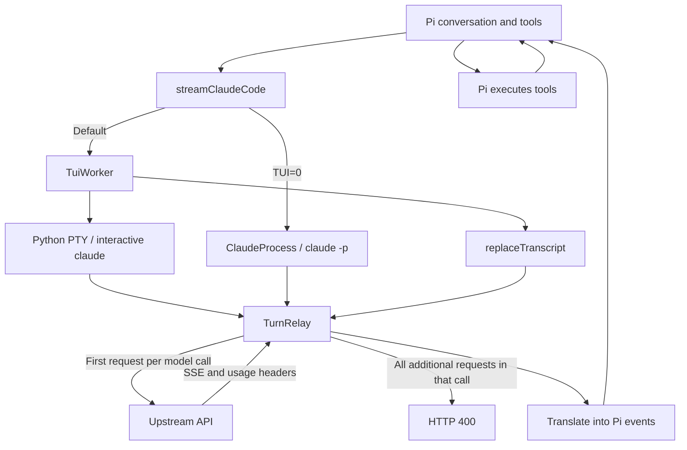
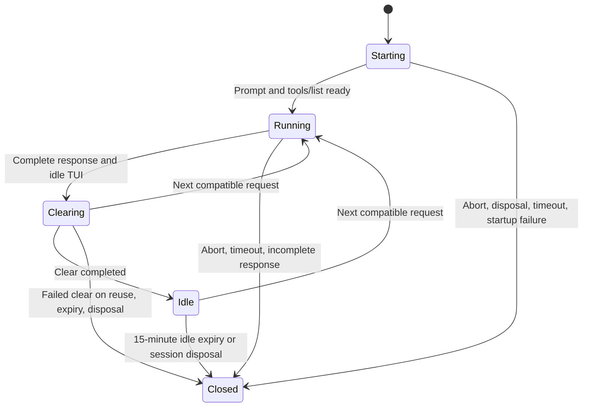

# Architecture

## Request flow

`stream.ts` calls `runTuiRequest` by default. Setting `PI_CLAUDE_CODE_TUI=0` selects the original `runClaudeRequest` path using `claude -p` and stream-json. Pi executes tools in both modes. Claude Code's inert MCP server advertises the tool inventory and returns placeholder results only.

## Startup and folder trust

`TuiSession` starts Claude Code in a 200-column, 50-row PTY through `python3 src/pty-helper.py`. `createTerminalResponder` retains incomplete terminal-query suffixes and responds once to each query, including queries split across chunks or repeated in one chunk. Input is submitted only after the prompt has remained stable for 300 ms and the inert MCP `tools/list` completion marker exists. The default ready timeout is 45 seconds; a supplied `timeoutMs` overrides it.

Folder trust is approved automatically only when `PI_CLAUDE_CODE_TUI_TRUST=1`: the session selects Yes with the down key and waits 300 ms before pressing Enter. Otherwise, a trust prompt or a sign-in prompt fails the request. A missing Python executable is surfaced as a request error rather than an unhandled process error.

## Conversation replay and caching

Pasting `continue` into the TUI triggers one upstream request. The relay's `replaceTranscript` preserves Claude Code's leading user system-reminder blocks, then inserts Pi's prompt and first user message. It appends the rest of Pi's conversation and supported system/tool changes, discarding `/clear` artifacts and moving trailing system information.

`injectNativeSystemMessages` is shared between `claude-cli.ts` and the TUI path. It restores intermediate instructions and tool changes at their original assistant boundaries without mutating input frames or injections. Claude Code's original API system prompt and tool definitions are retained.

The entire body is limited to four cache breakpoints. The actual system and tool annotations determine the remaining budget for messages. Older environment/message markers are removed before later markers. Removal and counting follow protocol `content` blocks only: identically named keys in `tool_use.input` or `input_schema` are preserved and do not count as breakpoints. If the original system and tools alone exceed four markers, the request fails without rewriting them.

## Turn boundaries and reuse

A completed duration line, including seconds, minutes, or hours, and a following prompt identify an idle TUI. The response is returned from the captured SSE after relay completion. HTTP 200, `message_stop`, a response message, numeric usage, and tool names from Pi's current inventory are required. HTTP 400 and truncated SSE streams are errors.

After a successful call, `/clear` runs asynchronously; reuse waits for it to finish. A different working directory, model, environment, prompt, tool manifest, extra body, timeout, or upstream URL creates a new worker. Each call restores the full Pi history, so Pi branches and edited history do not inherit the previous TUI conversation.

At most one worker is cached per session and two across the extension. Idle workers expire after 15 minutes using an unreferenced timer, which is cleared when work starts. Concurrent requests for the same session and requests without session IDs use disposable workers. Close is idempotent and removes the relay, PTY, and temporary directory.

## Cancellation and authentication

`tui-lifecycle.ts` tracks requests with `trackTuiRequest` before worker-cache registration, including startup and disposable concurrent workers. `closeTuiProcesses` aborts matching requests and waits for both cached-worker closure and tracked-request cleanup. A disposed request cannot complete startup and send upstream or register a surviving worker.

The Python helper cleans the forkpty child's process group on stdin EOF, SIGTERM/SIGHUP/SIGINT, leader exit, PTY termination, or relay I/O errors. It detects leader exit with `waitid(WEXITED | WNOHANG | WNOWAIT)` every 0.1 seconds, even if a grandchild still holds the PTY open. Cleanup closes the PTY, sends SIGHUP and SIGCONT, waits 0.25 seconds, sends SIGKILL, then calls `waitpid`. Delaying reaping prevents leader PID reuse during group cleanup. Descendants escaping with `setsid`/`setpgid` and SIGKILL of the helper itself are outside this guarantee. See [ADR-0001](docs/adr/0001-pty-cleanup.md).

Claude Code manages credentials. This extension does not read credential files or save/refresh tokens. Authenticated headers temporarily pass through a loopback-only relay with a random route. API-key, external-proxy, Bedrock, Vertex, and Foundry environment overrides remain rejected.

## Usage-credit guard

The print path consumes `rate_limit_event`; the TUI path consumes upstream `anthropic-ratelimit-unified-*` headers. `rateLimitFromHeaders` treats a rejected plan status with an `allowed` or `allowed_warning` overage status as usage-credit billing.

Unless explicitly allowed, a response reporting usage credits becomes a billing error. Upstream third-party usage rejections are also normalized to non-retryable billing errors. Detection happens after the response and cannot prevent the first charge. Future header meanings and upstream classification are not guaranteed. Diagnostics expose the latest state as `claude-code.rate-limit`.

Pi's prompt in a user message does not have system-level priority. Successful requests and technical review are distinct from authorization under service terms or billing guarantees. See the [test report](docs/spike-2026-11-03.md).

## Design references

The provider and relay are derived from [earendil-works/pi-claude-code](https://github.com/earendil-works/pi-claude-code). PTY interaction behavior was informed by [yetone/magpie](https://github.com/yetone/magpie), including terminal queries, settling delays, and prompt detection. Response capture remains relay-based, not magpie's JSONL/tap approach. Attribution and the reference MIT notice are in [THIRD_PARTY_NOTICES.md](THIRD_PARTY_NOTICES.md).
