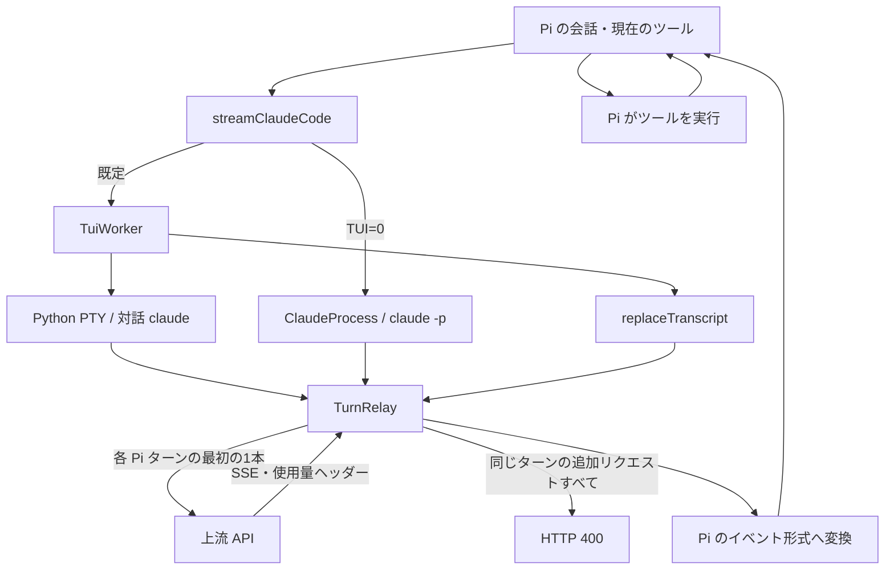
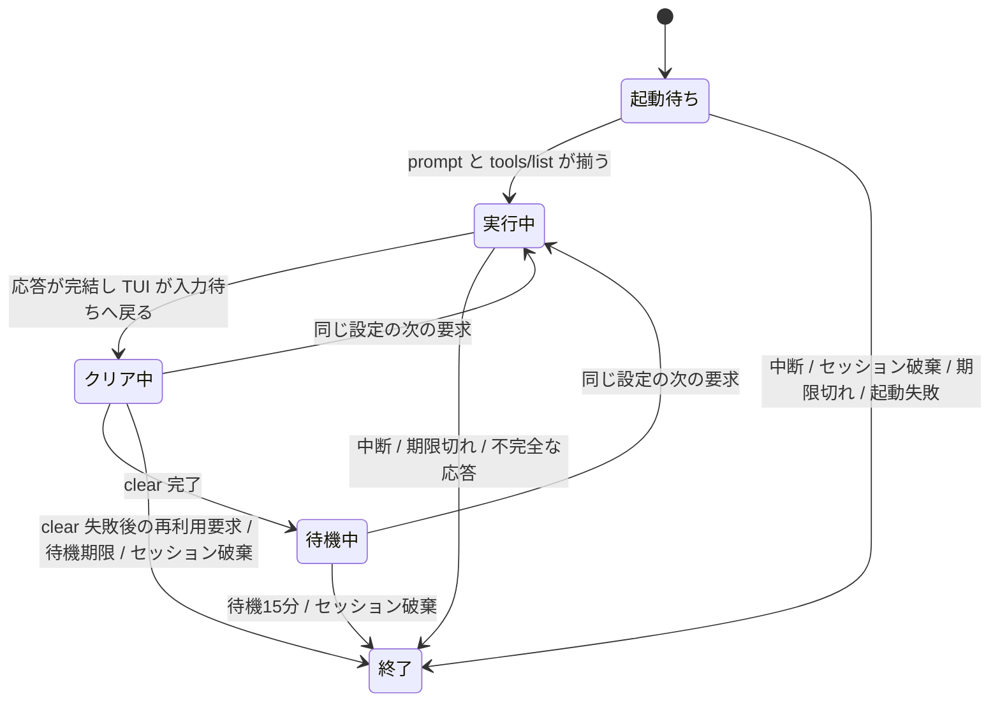

# 内部構成

## リクエスト経路

`stream.ts` は、既定で `runTuiRequest` を呼ぶ。`PI_CLAUDE_CODE_TUI=0` のときだけ、元の `runClaudeRequest` による `claude -p` と stream-json の経路を使う。どちらも Pi がツールを実行し、Claude Code の MCP はツール一覧を提示してダミーの実行結果を返すだけである。

## 起動とフォルダ信頼

`TuiSession` は `python3 src/pty-helper.py` 経由で200列・50行の PTY に Claude Code を起動する。`createTerminalResponder` がチャンク末尾の未完了な端末問い合わせを保持し、分割配送と連続する問い合わせにも一度ずつ応答する。入力欄が300ms安定したことと inert MCP の tools/list 完了マーカーの両方を確認してから貼り付ける。既定の起動待ちは45秒で、要求に `timeoutMs` があればその値を使う。

フォルダ信頼確認は、`PI_CLAUDE_CODE_TUI_TRUST=1` のときだけ No から下キーで Yes を選び、300ms安定してから Enter を送る。未許可の信頼確認やログイン要求はエラーで停止する。Python の起動失敗も未処理例外にせず要求のエラーとして返す。

## 会話とキャッシュ

TUI へ貼る `continue` は、上流への1回の要求を発生させるきっかけである。relay の `replaceTranscript` は、先頭 user の Claude Code 本来の system-reminder を残し、その後ろに Pi プロンプトと Pi の最初の user を置く。Pi の残りの会話と対応モデルの system／ツール差分を続け、`/clear` の痕跡や変動する末尾の system 情報は捨てる。

`injectNativeSystemMessages` は `claude-cli.ts` と TUI 経路で共有し、途中の指示やツール追加・削除を元の assistant 境界に復元する。入力の会話配列や差分は変更しない。Claude Code 本来の API system と tools は保持する。

キャッシュ区切りは本文全体で4個以内にする。system と tools の区切り数を実際の本文から数え、messages には残りの枠だけを使う。環境 system の古い区切りは外し、末尾の区切りを優先して保持する。注釈の除去と個数の集計はプロトコルの content ブロックだけを辿り、tool_use.input やツール定義の input_schema に含まれる同名のキーは変更せず、区切りにも数えない。上流本来の system と tools だけで4個を超える場合は、それらを書き換えずエラーにする。

## ターンの境界と再利用

秒・分・時を含む TUI の終了行と入力欄が現れ、relay の通信が完了したら、SSE の正本から応答を返す。HTTP 200・message_stop・応答本文・使用量の数値が揃い、ツール名が Pi の現在の一覧にあることを検証する。HTTP 400 や切断途中の SSE は成功にしない。

成功後は次の要求までに `/clear` を非同期で実行する。再利用時にはその完了を待つ。作業フォルダ・モデル・環境・プロンプト・ツール一覧・extra body・タイムアウト・上流 URL が違えば、新しいプロセスを起動する。会話自体は毎回丸ごと復元するため、Pi の分岐・履歴編集でも TUI の前の会話を引き継がない。

保持するプロセスは全体で最大2個、待機期限は15分で、期限のタイマーは Node の終了を妨げない。使用開始時には期限タイマーを解除する。同一セッションへの並行要求は別プロセスに分離し、セッション ID がない要求も使い捨てにする。close は冪等で、relay・PTY・一時ディレクトリを破棄する。

## 中断と認証

`tui-lifecycle.ts` の `trackTuiRequest` は、キャッシュ登録より前に各要求を追跡する。起動中・実行中・使い捨ての並行要求のすべてが対象である。`closeTuiProcesses` は該当する要求のシグナルを中断し、キャッシュされた worker の close と追跡要求の清掃完了を待つ。破棄済みの要求が起動を終えても上流には送信せず、その worker を残さない。

Python helper は、stdin EOF・SIGTERM／SIGHUP／SIGINT・Claude 本体の終了・PTY 終了・中継 I/O エラーの終了経路で、forkpty の子プロセスグループを清掃する。本体の終了は、0.1秒周期の waitid(WEXITED | WNOHANG | WNOWAIT) で reap せず検出する。これにより孫が PTY を保持して EOF が来ない場合も清掃へ進む。PTY を閉じ、グループへ SIGHUP と SIGCONT を送り、0.25秒の猶予後に SIGKILL を送ってから直接の子を waitpid する。清掃前には子を reap せず、PID の再利用による誤送信を避ける。同じグループを抜けた setsid／setpgid の子孫と helper 自体への SIGKILL は保証対象外である。詳細は [ADR-0001](docs/adr/0001-pty-cleanup.md) を参照する。

Claude Code が認証情報を管理する。拡張は認証ファイルを読まず、トークンを保存・更新しない。ただし認証済みリクエストのヘッダーは、ランダムな経路を持つループバック限定の relay を一時的に通過する。API キー・外部プロキシ・Bedrock・Vertex・Foundry への継承設定は従来どおり拒否する。

## 課金ガード

`-p` 経路は rate_limit_event、TUI 経路は上流レスポンスの anthropic-ratelimit-unified-* ヘッダーを使う。`rateLimitFromHeaders` が、プラン枠の status が rejected で overage-status が allowed または allowed_warning の状態を使用量クレジットへの計上として扱う。

使用量クレジットへの計上が報告された応答は、明示的に許容していなければ課金エラーにする。上流のサードパーティ利用に対する拒否も再試行しない課金エラーに整形する。判定は応答後なので初回の課金を未然に防ぐ保証はなく、ヘッダーの意味や上流判定の将来の互換性も保証しない。最新状態は claude-code.rate-limit 診断に付ける。

Pi プロンプトの user 配置は system 指示と同じ優先順位を持たない。実機で成功したことと、利用条件上の許可・課金計上の保証は区別する。独立レビューと実機検証の記録は [試験結果](docs/spike-2026-11-03.md) を参照する。
