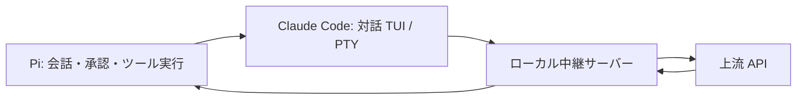

# pi-claude-code-tui

[](LICENSE)


Claude Code の対話画面（TUI）を使う、Pi 向けの実験的なモデルプロバイダです。

Pi が会話・承認・ツール実行を管理し、Claude Code は疑似端末（PTY）上でモデルと通信します。[earendil-works/pi-claude-code](https://github.com/earendil-works/pi-claude-code) から派生した非公式の拡張です。

## 特徴

- **対話 TUI を使用** — 既定では `claude -p` を使わず、PTY 上で Claude Code を起動します。
- **ツール実行は Pi が担当** — Claude Code には Pi のツール一覧を提示し、実際の承認と実行は Pi で行います。
- **会話履歴を復元** — ターンごとに Pi の会話を渡し、Claude Code のプロセスを再利用します。
- **従来の起動方式も選択可能** — 環境変数で `claude -p` に切り替えられます。エラー時の自動切り替えは行いません。

## 動作環境

| 項目 | 要件 |
|---|---|
| Node.js | 24.21 以上 |
| Python | 3.9 以上。`python3` コマンドで実行できること |
| OS | Linux／macOS。Python の `os.forkpty`・`os.waitid`・`os.WNOWAIT` が利用できること |
| Pi | インストール済みであること |
| Claude Code | インストール済みで、`claude auth login` によるログインが完了していること |

実機確認は WSL2・Node.js 24.22.2・Claude Code 2.1.316・Haiku 5.5 で行っています。macOS は実機未検証です。Windows ネイティブの ConPTY には対応していません。

## インストール

npm には公開していません。リポジトリを clone して利用してください。

```sh
git clone https://github.com/MINTY1st/pi-claude-code-tui.git
cd pi-claude-code-tui
npm ci
```

## 使い方

### 1. Claude Code にログインする

```sh
claude auth login
```

利用する作業フォルダで通常の `claude` を一度起動し、フォルダの信頼確認を済ませてから終了してください。この拡張は、既定では信頼確認に自動で Yes と答えません。

### 2. 拡張を読み込んで Pi を起動する

利用する作業フォルダで、clone した拡張の絶対パスを指定します。

```sh
pi -e /absolute/path/to/pi-claude-code-tui/src/index.ts
```

Pi のモデル選択で **Claude Code Subscription (Experimental)** を選んでください。検出状況は Pi の `/claude-code-status` で確認できます。

既存の同名プロバイダ拡張と競合する場合は、他の拡張を無効にして起動してください。

```sh
pi -ne -e /absolute/path/to/pi-claude-code-tui/src/index.ts \
  --provider claude-code --model haiku
```

clone しただけでは、普段の Pi の設定・モデル・拡張は切り替わりません。

## 設定

| 環境変数 | 既定値 | 説明 |
|---|---|---|
| `PI_CLAUDE_CODE_TUI` | 未設定（TUI 有効） | `0` で従来の `claude -p` を使用します。 |
| `PI_CLAUDE_CODE_TUI_TRUST` | 未設定（自動承認なし） | `1` で指定した作業フォルダの信頼確認に自動で Yes と答えます。信頼するフォルダでのみ設定してください。 |
| `PI_CLAUDE_CODE_COMMAND` | `claude` | Claude Code の実行ファイル名またはパス。 |
| `PI_CLAUDE_CODE_CONFIG_DIR` | 未設定 | Claude Code に渡す設定ディレクトリ。`CLAUDE_CONFIG_DIR` に対応します。 |
| `PI_CLAUDE_CODE_ALLOW_USAGE_CREDITS` | 未設定（許容しない） | `1` で使用量クレジットを使用した応答を許容します。 |

ログイン・ログアウトには `claude auth login`／`claude auth logout` を使います。認証情報は Claude Code が管理し、この拡張は認証ファイルを読んだり複製したりしません。ただし、認証済みリクエストのヘッダーはローカルの中継サーバーを通過します。

## 仕組み



各モデル呼び出しの最初のリクエストだけを上流へ転送し、同じ呼び出しで Claude Code が発生させる追加リクエストは拒否します。応答後は `/clear` で Claude Code 側の履歴を空にし、次の呼び出しで Pi の会話履歴を復元します。通常の Claude Code のセッション再開とは異なる方式です。

Pi のプロンプトは API の system ではなく、最初の user メッセージに置きます。Claude Code 本来の system 指示を残すため、Pi の指示は system 指示と同じ優先順位にはなりません。内部構成は [ARCHITECTURE.md](ARCHITECTURE.md) を参照してください。

## 既知の制限

- Claude Code の画面表示に依存します。バージョン更新で入力待ちやターン終了を検出できなくなる場合があります。
- 実機試験で1回、試験スクリプトの100秒期限に到達しました。再試行は成功しましたが、原因は未特定です。[試験記録](docs/spike-2026-11-03.md#単発の実機タイムアウト)を参照してください。
- 子孫プロセスの清掃は同じプロセスグループ内が対象です。`setsid`／`setpgid` で脱出した子孫や、PTY helper 自体への SIGKILL は保証対象外です。
- Pi セッションごとに1プロセス、拡張全体で最大2プロセスをキャッシュし、待機15分で破棄します。セッション ID がない要求や並行要求は使い捨てプロセスで処理します。
- ツールスキーマの `oneOf`・`allOf`・`anyOf`・nullable などは単純化される場合があります。途中のツール追加・削除の履歴保持は対応モデルに限られます。

## 開発

```sh
npm ci
npm test
npm run check
npm pack --dry-run
```

テストは偽の Claude Code とローカル上流を使い、実サービスへのモデルリクエストは送信しません。PTY のテストでは実際に子プロセスを起動するため、`python3` が必要です。パッケージは `private: true` としており、npm への公開対象にはしていません。

## ドキュメント

- [内部構成](ARCHITECTURE.md)
- [実機試験・回帰テストの記録](docs/spike-2026-11-03.md)
- [PTY の終了処理に関する ADR](docs/adr/0001-pty-cleanup.md)

## ライセンス

[MIT](LICENSE)。派生元 [earendil-works/pi-claude-code](https://github.com/earendil-works/pi-claude-code) の著作権表示を保持しています。
