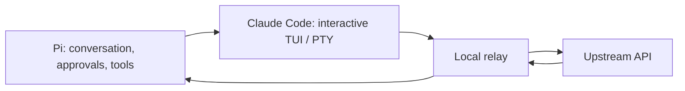

# pi-claude-code-tui

[](LICENSE)


An experimental [Pi](https://pi.dev) model provider that runs Claude Code's interactive terminal UI in a pseudo-terminal (PTY).

Pi manages conversations, approvals, and tool execution. Claude Code handles model communication. This is an unofficial fork of [earendil-works/pi-claude-code](https://github.com/earendil-works/pi-claude-code), with PTY interaction techniques informed by [yetone/magpie](https://github.com/yetone/magpie).

## Features

- **Interactive TUI transport** — Runs Claude Code in a PTY instead of using `claude -p` by default.
- **Pi-managed tools** — Pi owns tool approval and execution; Claude Code receives Pi's tool inventory through an inert MCP server.
- **Conversation replay** — Restores Pi's conversation for each model call while reusing compatible Claude Code processes.
- **Optional print mode** — Select the original `claude -p` transport with an environment variable. Errors never trigger an automatic fallback.

## Requirements

| Component | Requirement |
|---|---|
| Node.js | 24.21 or later |
| Python | 3.9 or later, available as `python3` |
| OS | Linux or macOS with Python's `os.forkpty`, `os.waitid`, and `os.WNOWAIT` available |
| Pi | Installed |
| Claude Code | Installed and authenticated with `claude auth login` |

Live testing used WSL2, Node.js 24.22.2, Claude Code 2.1.316, and Haiku 5.5. macOS has not been tested on a real machine. Native Windows ConPTY is not supported.

## Installation

### From GitHub

```sh
pi install git:github.com/MINTY1st/pi-claude-code-tui
```

Restart Pi after installing the package.

### From npm — first release pending

The planned npm package is `@minty1st/pi-claude-code-tui`. It is not published yet; npm authentication and ownership of the scope must be verified before the first release. Once published, install it with:

```sh
pi install npm:@minty1st/pi-claude-code-tui
```

The unscoped name `pi-claude-code-tui` belongs to an unrelated package. Do not use that npm name to install this provider.

### From source

```sh
git clone https://github.com/MINTY1st/pi-claude-code-tui.git
cd pi-claude-code-tui
npm ci
```

From your working directory, load the extension using its absolute path:

```sh
pi -e /absolute/path/to/pi-claude-code-tui/src/index.ts
```

Cloning the repository alone does not change your normal Pi configuration, models, or extensions.

## Usage

### 1. Authenticate Claude Code

```sh
claude auth login
```

Run the regular `claude` command once in your working directory, complete the folder-trust prompt, and exit. This extension does not automatically approve folder trust by default.

### 2. Select the provider

Start Pi and select **Claude Code Subscription (Experimental)** in the model picker. Run `/claude-code-status` inside Pi to check detection and authentication.

If another extension registers the same provider, disable it before loading this package. To try a source checkout without other extensions:

```sh
pi -ne -e /absolute/path/to/pi-claude-code-tui/src/index.ts \
  --provider claude-code --model haiku
```

## Configuration

| Environment variable | Default | Description |
|---|---|---|
| `PI_CLAUDE_CODE_TUI` | Unset: TUI enabled | Set to `0` to use the original `claude -p` transport. |
| `PI_CLAUDE_CODE_TUI_TRUST` | Unset: no automatic approval | Set to `1` to automatically approve the working directory's folder-trust prompt. Use only for directories you trust. |
| `PI_CLAUDE_CODE_COMMAND` | `claude` | Claude Code executable name or path. |
| `PI_CLAUDE_CODE_CONFIG_DIR` | Unset | Configuration directory passed to Claude Code as `CLAUDE_CONFIG_DIR`. |
| `PI_CLAUDE_CODE_ALLOW_USAGE_CREDITS` | Unset: not allowed | Set to `1` to accept responses that use usage credits. |

Use `claude auth login` and `claude auth logout` to manage authentication. Claude Code owns credentials; this extension does not read or copy its credential files. Authenticated request headers do pass through the local relay.

## How it works



Only the first upstream request for each model call is forwarded. Additional requests generated by Claude Code during that call are rejected. After the response, `/clear` resets Claude Code's conversation; the next call restores Pi's history rather than resuming a native Claude Code conversation.

Pi's prompt is placed in the first user message, not in the API system prompt. Claude Code's original system instructions remain in place, so Pi's instructions do not have system-level priority. See [ARCHITECTURE.md](ARCHITECTURE.md) for details.

## Known limitations

- Screen detection depends on Claude Code's terminal output and can break after a Claude Code update.
- One live test hit the test script's 100-second deadline. Retries succeeded, but the cause remains unknown. See the [test report](docs/spike-2026-11-03.md#isolated-live-test-timeout).
- Descendant cleanup covers the same process group only. Processes that escape with `setsid` or `setpgid`, or a SIGKILL sent directly to the PTY helper, are outside this guarantee.
- At most one process is cached per Pi session and two across the extension. Idle workers expire after 15 minutes. Requests without a session ID and concurrent requests use disposable processes.
- Complex tool schemas, including `oneOf`, `allOf`, `anyOf`, and nullable variants, may be simplified. Mid-conversation tool inventory changes are preserved only on supported models.

## Development

```sh
npm ci
npm test
npm run check
npm pack --dry-run
```

Tests use a fake Claude Code executable and a local upstream server. They do not send model requests to the real service. PTY tests start real child processes and require `python3`.

Publishing configuration uses a scoped package name, public access, and the `pi-package` keyword. The keyword makes a published npm package eligible for discovery in the [Pi package gallery](https://pi.dev/packages); immediate indexing is not guaranteed.

## Documentation

- [Architecture](ARCHITECTURE.md)
- [Live experiments and regression tests](docs/spike-2026-11-03.md)
- [ADR: PTY process-group cleanup](docs/adr/0001-pty-cleanup.md)
- [Third-party notices](THIRD_PARTY_NOTICES.md)

## Acknowledgements

- [earendil-works/pi-claude-code](https://github.com/earendil-works/pi-claude-code) by Armin Ronacher — the fork's foundation, including provider integration, conversation conversion, and the local relay.
- [yetone/magpie](https://github.com/yetone/magpie) by yetone — reference for interactive Claude Code PTY operation, terminal-query responses, input settling, and prompt detection. This package uses its own relay-based transport rather than magpie's JSONL/tap response collection.

## License

[MIT](LICENSE). The original upstream copyright notice is retained. See [THIRD_PARTY_NOTICES.md](THIRD_PARTY_NOTICES.md) for the magpie reference and its MIT notice.
