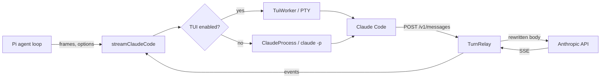

# Architecture

pi-claude-code-tui is a Pi provider that sends model calls through Claude Code, so requests are billed to the Claude subscription that Claude Code is logged in to. Pi keeps ownership of the conversation, tool execution and approvals; Claude Code only talks to the model.

## Two request paths

| Path | Selected by | How Claude Code runs |
|---|---|---|
| Interactive TUI (default) | `PI_CLAUDE_CODE_TUI` unset or not `0` | Claude Code's terminal UI runs in a pseudo-terminal (PTY). One process is reused per Pi session. |
| Print mode | `PI_CLAUDE_CODE_TUI=0` | `claude -p --input-format stream-json --output-format stream-json`, cached per session for up to 5 minutes. |

`streamClaudeCode` (`src/stream.ts`) picks the path for every call. Errors never fall back from one path to the other.

## The relay

In both paths Claude Code is started with `ANTHROPIC_BASE_URL` pointing to a local HTTP relay (`src/relay/turn-relay.ts`). For each Pi call:

1. Pi's conversation is converted to native Anthropic frames (`src/request/transcript.ts`).
2. A trigger message is submitted to Claude Code (`continue` in the TUI).
3. When Claude Code sends its `/v1/messages` request, the relay replaces the transcript with Pi's frames, writes per-turn values into the body (`src/tui/turn-body.ts`), forwards it upstream and streams the response back to both Claude Code and Pi.
4. Only the first upstream request of a call is forwarded. Any further request in the same call (for example Claude Code's own retry) is rejected with HTTP 400 and counted as a denied retry.

Authentication headers pass through the relay; the extension never reads Claude Code's credential files.

## Pseudo-terminal backends

`TuiSession` (`src/tui/pty-session.ts`) reads the screen and sends keys through a `PtyProcess` (`src/tui/pty-process.ts`). The backend is chosen by platform:

| Platform | Backend | Closing | Forced exit |
|---|---|---|---|
| Linux, macOS | `python3 pty-helper.py` (`os.forkpty`) | Closing the helper's stdin hangs up the terminal; the helper reaps the process group | `SIGKILL` to the helper |
| Windows | `@lydell/node-pty` (ConPTY), `src/tui/node-pty-process.ts` | Closing the pseudo-console | `taskkill /F /T` |

On Windows, `.cmd` and `.bat` launchers run through `cmd.exe /d /s /c` with a pre-quoted command line. Screen detection is the same on both backends; ConPTY's redrawn output has been checked only against the fake Claude Code in CI.

## Source map

Each folder under `src/` is one layer. Imports only point in the directions below; `tests/source-layout.test.ts` enforces this.

| Folder | Role | Files | May import |
|---|---|---|---|
| `src/` | Extension entry; picks the path for each call | `index.ts`, `provider.ts`, `stream.ts` | everything |
| `shared/` | Types and settings used everywhere | `native-types.ts`, `billing.ts`, `model-catalog.ts`, `env.ts` | `shared/` |
| `request/` | Converting Pi's conversation into native frames | `transcript.ts`, `tool-config.ts`, `tool-history.ts`, `tool-call-ids.ts`, `thinking-replay.ts`, `cache-breakpoints.ts`, `initial-request.ts`, `run-types.ts` | `shared/`, `request/` |
| `relay/` | Relay and response checks | `turn-relay.ts`, `relay-failure.ts`, `response-checks.ts`, `rate-limit-headers.ts` | `shared/`, `relay/` |
| `claude/` | Finding and starting the Claude Code executable | `claude-executable.ts`, `claude-models.ts`, `claude-spawn.ts`, `inert-mcp.mjs` | `shared/`, `claude/` |
| `tui/` | Interactive TUI path | `tui-process.ts`, `turn-body.ts`, `tui-transcript.ts`, `tui-screen.ts`, `tui-lifecycle.ts`, `pty-session.ts`, `pty-process.ts`, `pty-helper.py`, `node-pty-process.ts` | `shared/`, `request/`, `relay/`, `claude/`, `tui/` |
| `print/` | Print-mode path | `claude-print-process.ts`, `claude-print-cache.ts` | `shared/`, `request/`, `relay/`, `claude/`, `print/` |

## Related documents

- [Turn lifecycle](turn-lifecycle.md)
- [Errors and retries](errors-and-retries.md)
- [Worker reuse](worker-reuse.md)
