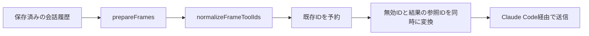

# 他プロバイダの履歴を再生する

OpenAI Responses のツール呼び出しIDは `call_…|ctc_…` のように縦棒を含む。Anthropic の `tool_use.id` は英数字、アンダースコア、ハイフンだけを受け付けるため、そのまま送ると HTTP 400 になる。

`prepareFrames` は送信フレームを組み立てた後に `normalizeFrameToolIds` を呼ぶ。有効なIDは保持し、無効なIDだけを SHA-256 由来の64文字のIDに置き換える。既存IDを先に予約し、変換先が衝突する場合は再計算する。呼び出しと結果には同じ対応表を使う。変換対象は送信フレームだけであり、入力の会話履歴や署名付き思考ブロックは変更しない。

## pi-web の信頼確認

tui は Claude Code をプロセスの作業ディレクトリで起動する。pi-web の場合、そのディレクトリがプロジェクトではなく pi-web のインストール先になる場合がある。

信頼確認は既定で自動承認しない。端末で対象ディレクトリを確認して承認するか、信頼できる環境に限って `PI_CLAUDE_CODE_TUI_TRUST=1` を起動元へ設定する。systemd サービスは通常 `.bashrc` を読まないため、シェルだけに設定してもサービスには反映されない。

## 検証

`tests/cross-provider-ids.test.ts` で、GPT由来のID、変換先の衝突、既存IDの保持、決定性、入力履歴の保持、空文字、非ASCII、長い複合IDを検証する。`tests/transcript.test.ts` などの既存テストで、ネイティブ履歴の再生と署名付き思考ブロックの保持を検証する。
