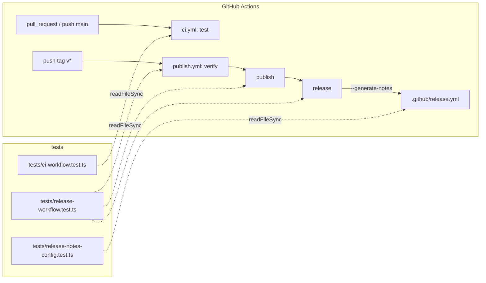

# PR 用 CI とリリースノート自動作成の構成

本書は [design.md](design.md) の仕様を、ファイルの完成形・テストファイルの構成・関数名まで具体化する。実装担当は本書の完成形をそのまま書き写す。完成形と異なる書式（キーの順序、引用符の有無、インデント）は、テストの正規表現が一致しなくなるため変えない。

## 1. 構成の全体像

本変更はアプリケーションの層を持たない。構成要素は「ワークフロー定義（YAML）」と「その構成を固定するテスト（TypeScript）」の 2 種類で、依存の向きは常にテストから YAML への一方向である。YAML 側はテストを参照しない。



| 要素 | 責務 | 持たない責務 |
| --- | --- | --- |
| `ci.yml` | PR と main の検査 | 公開、artifact、所有者判定 |
| `publish.yml` の `verify` | 公開前の検査と tarball 作成（変更なし） | 公開、Release |
| `publish.yml` の `publish` | npm への公開（変更なし） | Release |
| `publish.yml` の `release` | GitHub Release の作成 | checkout、npm 操作、Action 利用 |
| `.github/release.yml` | リリースノートのラベル分類 | ラベルの作成・付与 |
| テスト 3 ファイル | 上記の構成を文字列検査で固定する | YAML の解釈・実行 |

## 2. ファイルの完成形

### 2.1 `.github/workflows/ci.yml`（新規）

SHA は `publish.yml` の値と同一にする。新しい SHA を調べて差し替えてはならない。

```yaml
name: CI

on:
  pull_request:
  push:
    branches:
      - main

permissions:
  contents: read

jobs:
  test:
    runs-on: ubuntu-latest
    timeout-minutes: 10
    steps:
      - uses: actions/checkout@11d5960a326750d5838078e36cf38b85af677262 # v4
        with:
          persist-credentials: false
      - uses: actions/setup-node@49933ea5288caeca8642d1e84afbd3f7d6820020 # v4
        with:
          node-version: '24.22.2'
      - run: npm ci --ignore-scripts
      - run: npm test
      - run: npm run check
```

`fetch-depth` は指定しない。CI は `release-guard.mjs` を実行せず、履歴を必要としないためである。

### 2.2 `.github/workflows/publish.yml`（変更）

既存の内容は 1 文字も変えず、ファイル末尾（`publish` ジョブの `npm publish ...` 行の後）に空行 1 行と次のブロックを追記する。ジョブ名の行は先頭 2 スペースの `  release:` とする（テストが `"\n  release:\n"` で分割するため）。

```yaml

  release:
    needs: publish
    if: github.actor == github.repository_owner
    runs-on: ubuntu-latest
    timeout-minutes: 5
    permissions:
      contents: write
    steps:
      - name: Create GitHub Release with generated notes
        env:
          GH_TOKEN: ${{ github.token }}
          GH_REPO: ${{ github.repository }}
        run: gh release create "$GITHUB_REF_NAME" --generate-notes --verify-tag
```

守る点は次のとおり。

- `run:` は 1 行で書く（ブロック記法 `|` にしない）。テストが 1 行の正規表現で検査するためである。
- `$GITHUB_REF_NAME` はシェル変数として二重引用符で囲む。`${{ github.ref_name }}` の式展開を `run:` に直接埋め込まない。式展開はシェルに渡る前に文字列置換されるため、タグ名にシェルの特殊文字が含まれた場合にコマンド注入の経路になる。
- `release` ジョブに `# ...` の説明コメントは足さない。`GH_REPO` が必要な理由は design.md に記録済みである。

### 2.3 `.github/release.yml`（新規）

```yaml
changelog:
  categories:
    - title: Bug fixes
      labels:
        - fix
    - title: Features
      labels:
        - feature
    - title: Documentation
      labels:
        - docs
    - title: CI and maintenance
      labels:
        - ci
        - chore
```

### 2.4 `README.md`（変更）

Development 節のコードブロック直後の段落（`Tests use a fake Claude Code ...` で始まる段落）の後に、次の 1 段落を足す。

```markdown
[The CI workflow](.github/workflows/ci.yml) runs `npm ci --ignore-scripts`, `npm test`, and `npm run check` on Node 24.22.2 for every pull request and every push to `main`.
```

Publishing 節の `Tests and type checks run without publishing credentials; ...` の行の直後に、次の 2 行を足す（既存の 1 文 1 行の書き方に合わせる）。

```markdown
After the package is published, a third job creates the GitHub Release for the tag with generated notes; only that job has `contents: write`.
The notes group pull requests by the labels `fix`, `feature`, `docs`, and `ci`/`chore` as defined in [.github/release.yml](.github/release.yml).
```

## 3. テストファイルの構成

### 3.1 共通の方針

- 3 ファイルとも既存の `tests/release-workflow.test.ts` と同じ書き方にする。`node:assert/strict`・`node:fs` の `readFileSync`・`node:test` の `test` を import し、ファイル先頭で対象 YAML を `new URL("../<path>", import.meta.url)` で読み込む。
- YAML パーサーは使わない。文字列の `split` と正規表現で検査する。
- テスト名は日本語で、既存と同じく「〜する」「〜しない」の常体にする。
- テスト間で共有するヘルパーファイル（`tests/helpers/` 等）は作らない。各ファイルは自己完結させる。SHA 検査の数行が 2 ファイルで似るのは許容する（共通化のための新しいモジュールを足さないため）。
- `tsconfig.json` は `strict: true` で `tests/**/*.ts` も型検査する。配列の分割代入で得た値は既存と同じく `!` で非 null を明示する。
- 1 ファイル 100 行以内、1 テスト 20 行以内を目安とする。

### 3.2 `tests/release-workflow.test.ts`（変更）

ファイル先頭の分割を 3 ジョブ構成に変える。

変更前:

```ts
const [verification, publishing] = workflow.split("\n  publish:\n");
```

変更後:

```ts
const [verification, afterVerification] = workflow.split("\n  publish:\n");
const [publishing, releasing] = afterVerification!.split("\n  release:\n");
```

この変更により `publishing` は `publish` ジョブだけを指し、`releasing` は `release` ジョブだけを指す。既存テストの変更点は次の 1 か所だけとする。

| 既存テスト名 | 変更内容 |
| --- | --- |
| `公開はタグpushだけを起点とし、所有者とバージョン・mainの検査を経由する` | `if: github.actor == github.repository_owner` の件数の期待値を `2` から `3` に変える |

それ以外の既存テスト（`検証jobは...`、`公開するtarballは...`、`外部ActionsはコミットSHAに固定する`）は 1 文字も変えない。`外部ActionsはコミットSHAに固定する` の件数 `5` は、`release` ジョブが Action を使わないため据え置きで成立する。

追加するテストは [test-list.md](test-list.md) の「2. `publish.yml` の `release` ジョブ」に列挙したもので、テスト名も同表のとおりにする。

### 3.3 `tests/ci-workflow.test.ts`（新規）

先頭で 2 ファイルを読む。

```ts
const workflow = readFileSync(new URL("../.github/workflows/ci.yml", import.meta.url), "utf8");
const publishWorkflow = readFileSync(new URL("../.github/workflows/publish.yml", import.meta.url), "utf8");
```

ファイル内に次の関数を 1 つだけ定義する。

```ts
function pinnedActions(source: string): Map<string, string>
```

- 引数: ワークフローの YAML 文字列
- 戻り値: `uses: <name>@<ref>` の各出現について `name` → `ref` の Map
- 実装: `[...source.matchAll(/uses: ([^@\s]+)@(\S+)/g)]` を走査して `Map` に入れる
- 例外: 投げない。該当なしなら空の Map を返す

この関数は「`ci.yml` と `publish.yml` が同じ Action に同じ SHA を使う」テストで両ファイルに適用する。

ステップ順の検査は `indexOf` の大小比較で行う。`checkout@` < `setup-node@` < `npm ci --ignore-scripts` < `npm test` < `npm run check` の順に、各 `indexOf` が `-1` でなく、かつ単調増加であることを確かめる。

### 3.4 `tests/release-notes-config.test.ts`（新規）

先頭で 1 ファイルを読む。

```ts
const config = readFileSync(new URL("../.github/release.yml", import.meta.url), "utf8");
```

ファイル内に次の型と関数を定義する。

```ts
type Category = { title: string; labels: string[] };
function readCategories(source: string): Category[]
```

- 実装: `source.split("\n    - title: ").slice(1)` で区分ごとの塊に分け、各塊について 1 行目を `title`、`/^        - (\S+)$/gm` に一致する値を `labels` とする
- 戻り値: 出現順の `Category` 配列
- 例外: 投げない。区分が無ければ空配列を返す

検査は `assert.deepEqual(readCategories(config), [...])` で、design.md 5.3 の表と順序まで一致させる。

## 4. 例外・権限・同時実行・状態

| 観点 | 扱い |
| --- | --- |
| 業務エラーの変換 | 対象外。YAML とテストだけで、実行時の例外変換を持たない。テストは `assert` の失敗で落ちるだけである |
| 権限 | ワークフロー既定は両ファイルとも `contents: read`。昇格はジョブ単位で `publish`（`id-token: write`、既存）と `release`（`contents: write`、新規）の 2 か所だけ |
| 同時実行 | `publish.yml` は既存の `concurrency: npm-release`（`cancel-in-progress: false`）の下で直列化される。`release` ジョブもこのワークフロー内なので直列化される。`ci.yml` には `concurrency` を書かない（design.md 未決事項 3） |
| トランザクション | npm 公開と Release 作成は別ジョブで、まとめて巻き戻す仕組みは無い。`release` の失敗は npm 公開を取り消さない（design.md 5.4） |
| 保存する値と導出する値 | 保存するのは YAML の定義だけである。Release の名前とタグは `GITHUB_REF_NAME` から導出し、リリースノートは GitHub が PR とラベルから導出する。バージョン番号を YAML に書かない |
| 古い応答の扱い | 対象外。リクエストと応答の対応を持つ処理が無い |

## 5. 作業順序

1. `tests/release-workflow.test.ts` の分割を変え、件数を `3` にし、`release` ジョブ用テストを足す。`npm test` で失敗（Red）を確かめる。
2. `publish.yml` に `release` ジョブを足し、Green にする。
3. `tests/release-notes-config.test.ts` を足して Red、`.github/release.yml` を足して Green にする。
4. `tests/ci-workflow.test.ts` を足して Red、`.github/workflows/ci.yml` を足して Green にする。
5. README を更新する。
6. `npm test` と `npm run check` を実行し、全件成功を確かめる。

---

更新履歴: 2026-11-07 初版（devflow/20261107-1024）
