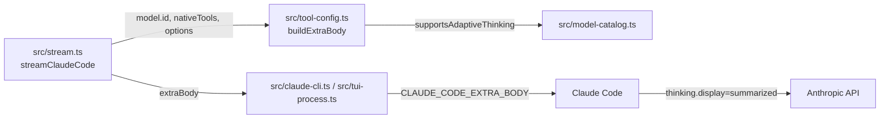

# 構成

## 結論

新しいファイル・関数・型は作らない。`src/tool-config.ts` の `buildExtraBody` 内の1行を書き換え、テストは既存の `tests/transcript.test.ts` に追記する。

## 層と依存の向き



- `buildExtraBody` はリクエスト本文の追加分を組み立てる純粋関数で、外部入出力を持たない。依存先は `supportsAdaptiveThinking` だけである。
- `src/transcript.ts` は `buildExtraBody` を再エクスポートしている。テストはこの再エクスポート経由で import している（既存の書き方に合わせる）。
- 依存の向きは変えない。`model-catalog.ts` から `tool-config.ts` への逆向きの import を作らない。

## 変更箇所（確定）

`src/tool-config.ts` の105行目を次のとおり変える。

変更前:

```ts
    if (supportsAdaptiveThinking(modelId)) body.thinking = { type: "adaptive" };
```

変更後:

```ts
    // Opus 4.7 以降の API は display 省略時に omitted となり思考本文を返さないため、Pi 本体と同じ summarized を明示する
    if (supportsAdaptiveThinking(modelId)) body.thinking = { type: "adaptive", display: "summarized" };
```

- コメントは「なぜ」だけを書く規約に従い、上の1行のみとする。
- オブジェクトリテラルを毎回生成する。モジュールレベルの共有定数にしない（呼び出し側で変更されたときに他の呼び出しへ波及させないため）。
- `else` 側（`thinking: { type: "disabled" }`、既存の英語コメント、`context_management`）には触れない。

## 型

追加しない。戻り値は既存どおり `Record<string, unknown>`。`display` 用のユニオン型も定義しない。

## 例外の扱い

`buildExtraBody` は例外を投げない。業務エラーの変換は存在しない。

## トランザクション・同時実行・状態

- 永続化する状態はない。`body` は呼び出しごとのローカル変数である。
- 同時に複数のリクエストが走っても、呼び出し間で共有する可変状態がないので干渉しない。`supportsAdaptiveThinking` が参照する `ADAPTIVE_THINKING_BY_ID` は読み取りのみ。
- 古い応答の扱いは本変更と無関係である。

## テストの配置

- ファイル: `tests/transcript.test.ts`（新規ファイルは作らない）。
- 既存テスト（211行目付近の `assert.deepEqual(buildExtraBody("claude-sonnet-5", ...`）の期待値の `thinking` を `{ type: "adaptive", display: "summarized" }` に更新する。
- 追加テストは `test("buildExtraBody ...", () => { ... })` の形で、既存の `prepareTools` のテストの直後に置く。テスト名は英語で、既存ファイルの書き方（`node:test` の `test`、`node:assert/strict`）に合わせる。
- 比較は `assert.deepEqual` でオブジェクト全体を比べる。`display` が無いことの確認も全体一致で行う。

## 規模の目安

- `buildExtraBody` は変更後も約20行で、50行以内に収まる。
- `src/tool-config.ts` は116行で、300行以内に収まる。
- 追加テストは合計60行以内を目安にする。
