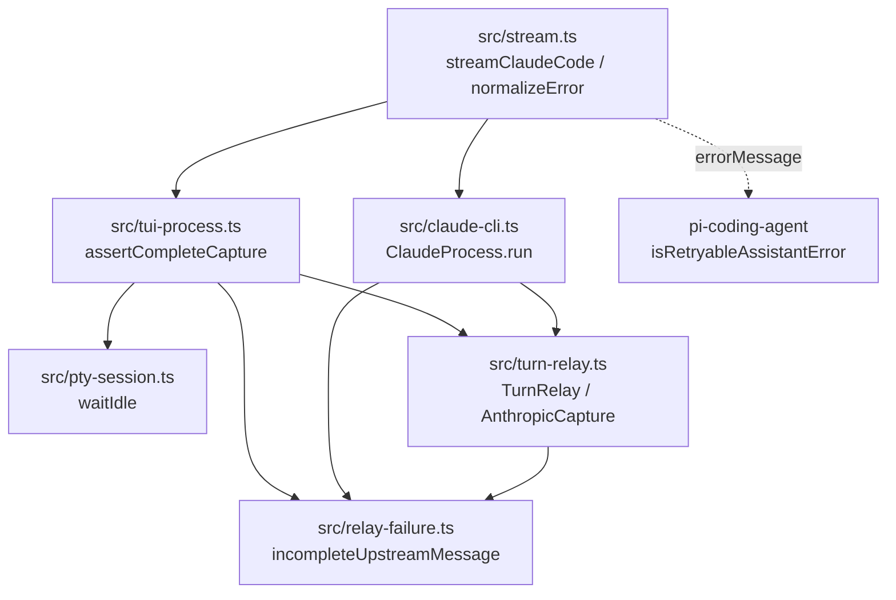

# 構成

## 結論

新規ファイルは `src/relay-failure.ts`（本体）と `tests/relay-failure.test.ts`・`tests/turn-relay-failure.test.ts`（テスト）の3つである。最終エラー文言の組み立ては `incompleteUpstreamMessage` の1か所に集め、`tui-process.ts` と `claude-cli.ts` の重複した組み立てを削除する。`TurnRelay` は「どの段階で失敗したか」と例外の記述を保存し、一時的かどうかと最終文言は保存せず毎回導出する。

お手本（すべて一時コピーのリポジトリで `npm test` と `npm run check` の合格を確認済み）:

| お手本 | 使い方 |
| --- | --- |
| `examples/relay-failure.ts` | そのまま `src/relay-failure.ts` にコピーする |
| `examples/relay-failure.test.ts` | そのまま `tests/relay-failure.test.ts` にコピーする |
| `examples/turn-relay-failure.test.ts` | そのまま `tests/turn-relay-failure.test.ts` にコピーする |
| `examples/src-changes.diff` | `src/turn-relay.ts`・`src/tui-process.ts`・`src/claude-cli.ts`・`src/pty-session.ts` の確定差分。`git apply` で当てられる（`git apply --check` 確認済み） |
| `examples/tests-changes.diff` | `tests/turn-relay.test.ts`・`tests/pty-session.test.ts` の確定差分 |

TDD の順序は test-list.md に従う。お手本は完成形であり、Red を確かめるときはテストを先に置き、本体を後から入れる。

## 層と依存の向き



- `src/relay-failure.ts` は葉のモジュールである。`node:*` も他の `src/*` も import しない。`TurnRelay` 型も import せず、必要な形を `RelayOutcome` として構造的に定義する（`turn-relay.ts` との循環 import を作らないため）。
- `turn-relay.ts` は `relay-failure.ts` から `CaptureError`・`relayFailure`・型 `RelayFailure`・`RelayFailureKind` だけを import する。
- `tui-process.ts` と `claude-cli.ts` は `incompleteUpstreamMessage` だけを import する。`TurnRelay` のインスタンスをそのまま渡す（`RelayOutcome` を構造的に満たす）。
- `pty-session.ts` は `relay-failure.ts` に依存しない。無応答の文言は `waitIdle` の `describe` 文字列だけで決める。
- `stream.ts` は変更しない。

## 型（`src/relay-failure.ts`）

```ts
export type RelayFailureKind = "request" | "connect" | "disconnect" | "capture";

export interface RelayFailure {
  kind: RelayFailureKind;
  summary: string; // 例: "Error [ECONNRESET]"、"AggregateError [ECONNREFUSED]"、Error 以外は "UnknownError"
  detail: string;  // describeError の結果（最大1000文字 + "…"）
}

export interface RelayOutcome {
  status?: number;
  failure?: RelayFailure;
  denied: number;
  capture: { complete: boolean };
  errorText(): string;
}
```

| kind | 記録する段階（`TurnRelay.handle` 内） | 一時的 |
| --- | --- | --- |
| `request` | `readBody`・`transformRequest`・ヘッダー組み立て。上流へ要求を出す前 | しない |
| `connect` | `stage = "connect"` の代入（`transport.request` の直前）から、`response` イベントを受け取るまで | する |
| `disconnect` | `response` イベントを受け取った直後の `stage = "disconnect"` 以降（上流からの読み取り、TUI への書き込み、`waitForDrain`） | status が 400〜499 ならしない、それ以外はする |
| `capture` | 段階に関係なく、例外が `CaptureError` のとき | しない |

## 関数（`src/relay-failure.ts`）

| 関数 | 契約 |
| --- | --- |
| `describeError(error: unknown): string` | Error なら `<name>[ [<code>]][: <message>]`。code は string か number のときだけ付ける。message が空なら `: ` 以降を付けない。`AggregateError` で `errors` が1件以上なら末尾に ` (errors: <各要素の1行記述を "; " で連結>)`。内側の要素の `errors` は展開しない（1段のみ）。Error 以外は `String(error)`。全体が1000文字を超えたら先頭1000文字 + `…` |
| `new CaptureError(cause: unknown)` | `name = "CaptureError"`、`cause` に元の例外、`message = "Claude Code stream handling failed: " + describeError(cause)` |
| `relayFailure(kind, error): RelayFailure` | `summary` は Error なら `<name>[ [<code>]]`、それ以外は `"UnknownError"`。`detail` は `describeError(error)` |
| `isTransientRelayFailure({ status, failure })` | `connect` は常に true。`disconnect` は status が 400〜499 以外のとき true。それ以外と failure 無しは false |
| `incompleteUpstreamMessage(outcome): string` | 下の書式 |

`incompleteUpstreamMessage` の書式（要素の順序は固定）:

```text
[<固定句>: ]Incomplete Claude Code upstream response (status <status|unknown>, capture <complete|incomplete>[, relay failure <summary か detail>][, native retries denied <denied>][, upstream said: <errorText() の先頭500文字>])
```

- 固定句は一時的なときだけ付ける。`connect` は `Claude Code upstream connection error`、`disconnect` は `Claude Code upstream connection lost`。
- `relay failure` に出すのは、`disconnect` かつ status 400〜499 のときだけ `summary`、それ以外は `detail`。
- `native retries denied` は `denied > 0` のときだけ出す。`upstream said` は `errorText()` が空文字でないときだけ出す。

## `src/turn-relay.ts` の変更（確定。`examples/src-changes.diff` と同一）

1. import に `import { CaptureError, relayFailure, type RelayFailure, type RelayFailureKind } from "./relay-failure.ts";` を追加する。
2. `AnthropicCapture.feed` と `finish` の `this.consumeFrames()` を `this.consumeSafely()` に置き換え、次の private メソッドを `finish` の直後に追加する。`consumeFrames` と `apply` は変更しない。

```ts
  // relay が通信の失敗と区別できるように、解析と onEvent の例外だけを CaptureError で包む
  private consumeSafely(): void {
    try {
      this.consumeFrames();
    } catch (error) {
      throw new CaptureError(error);
    }
  }
```

3. `failure?: string;` を `failure?: RelayFailure;` に変える。`beginTurn` の `this.failure = undefined;` はそのまま残す。
4. コンストラクタから `private readonly timeoutMs = 180_000,` を削除する（引数は `upstream, onEvent, transformRequest, requestBetas` の4つになる）。
5. `handle` で `let upstreamRequest` の直後に `let stage: RelayFailureKind = "request";`、`transport.request` の直前の行に `stage = "connect";`、`await new Promise<http.IncomingMessage>(...)` の直後に `stage = "disconnect";` を置く。
6. `transport.request` の引数から `timeout: this.timeoutMs,` を削除する。代わりの `timeout` イベント処理は足さない。
7. `catch` の `this.failure = error instanceof Error ? error.name : "UnknownError";` を `this.failure = relayFailure(error instanceof CaptureError ? "capture" : stage, error);` に変える。TUI へ返す 499 / 502 / `destroy` の分岐は変えない。

## 呼び出し側の変更（確定）

- `src/tui-process.ts`: import に `incompleteUpstreamMessage` を追加する。`assertCompleteCapture` の `let detail = ...` の行から `throw new Error(...)` の行までの5行を `throw new Error(incompleteUpstreamMessage(relay));` の1行に置き換える。`new TurnRelay(...)` の第2引数 `input.timeoutMs ?? DEFAULT_TIMEOUT_MS` を削除する。`DEFAULT_TIMEOUT_MS` 定数は `waitIdle` で使い続けるので残す。
- `src/claude-cli.ts`: import に `incompleteUpstreamMessage` を追加する。`ClaudeProcess.run` の `if (this.relay.status !== 200 || ...)` の中の6行を `throw new Error(incompleteUpstreamMessage(this.relay));` の1行に置き換える。`new TurnRelay(...)` の第2引数 `plan.timeoutMs` を削除する。`plan.timeoutMs` は `ClaudeProcess` の `queue.next` で使い続けるので残す。
- `src/pty-session.ts`: `waitIdle` の `() => "Claude Code did not finish its turn"` を `() => "Claude Code timed out: it did not finish its turn"` に変える。`poll` は変えない。`ready`・`clear` の文言は変えない。

## 例外の扱い

- 業務エラーへの変換（最終文言の組み立て）は `incompleteUpstreamMessage` の1か所だけで行う。`tui-process.ts` と `claude-cli.ts` に文字列の組み立てを残さない。
- `CaptureError` は `AnthropicCapture` が投げ、`TurnRelay.handle` の `catch` だけが受ける。relay の外に `CaptureError` を投げない。
- 無応答の打ち切りの例外は `TuiSession.poll` が投げ、`tui-process.ts` はそのまま上へ流す（包まない）。
- 新たな `try/catch` は `consumeSafely` の1つだけである。

## 状態の持ち方

| 値 | 保存 / 導出 | 置き場所 |
| --- | --- | --- |
| `failure`（kind・summary・detail） | 保存。ターンで最初に `handle` が失敗したときに1回だけ代入する | `TurnRelay.failure` |
| `stage` | 保存しない。`handle` のローカル変数 | `handle` |
| 一時的かどうか | 導出（`status` と `failure.kind`） | `isTransientRelayFailure` |
| 最終エラー文言 | 導出 | `incompleteUpstreamMessage` |

- `failure` の寿命はターン単位で、`beginTurn` が消す。
- `handle` は1ターンに1回しか上流へ進まない（`used` で2回目以降は 400 `PI_CLAUDE_CODE_TURN_RELAY_CONSUMED` で拒否し、`failure` に触れない）。このため `failure` を複数の要求が上書きし合うことはない。

## 同時実行と古い応答

- relay の `handle` は Node のイベントループ上で動き、`failure` の代入は `catch` 内の同期処理1回である。ロックは不要である。
- 接続失敗の 502 を受けた Claude Code が再送しても、`used = true` のため拒否され `denied` が増えるだけで、最初の `failure` は残る。
- `finishTurn`（ターン終了・中断）が `socket.destroy(new Error("Claude Code request aborted"))` を呼ぶと、進行中の `handle` の `catch` が `failure` を記録することがある。これはターン終了後の記録であり、最終文言は `finishTurn` より前の `assertCompleteCapture`（`tui-process.ts`）・`ClaudeProcess.run`（`claude-cli.ts`）で組み立て済みなので影響しない。次のターンの `beginTurn` が消す。`beginTurn` は `active.size > 0` のとき例外を投げる既存の防御を持つため、前のターンの `handle` が次のターンの `failure` を書くことはない。
- 中断（`signal.aborted`）の場合、`stream.ts` が `stopReason: "aborted"` にする。pi-ai は aborted を再試行しない。本変更はこの経路を変えない。

## テストの配置と書き方

- テストは `node:test` の `test` と `node:assert/strict` を使い、テスト名は日本語で書く（`tests/turn-relay.test.ts` 後半・`tests/pty-session.test.ts` と同じ）。
- 再試行判定は必ず `import { isRetryableAssistantError, type AssistantMessage } from "@earendil-works/pi-ai";` を呼ぶ。パターンを自前で書かない。`AssistantMessage` は `{ stopReason: "error", errorMessage } as AssistantMessage` の最小オブジェクトで作る。
- relay 経由のテストでは、Pi と同じ経路にするため `normalizeError(new Error(incompleteUpstreamMessage(relay)))` を判定に渡す。
- `tests/turn-relay.test.ts` は既存171行に追記すると見通しが悪くなるため、失敗系は新規 `tests/turn-relay-failure.test.ts` に置く。既存ファイルは `new TurnRelay` の `5_000` 引数を4か所削除するだけにする。

## 規模の目安

| ファイル | 変更後の行数 | 判定 |
| --- | --- | --- |
| `src/relay-failure.ts` | 90 | 300以内 |
| `src/turn-relay.ts` | 389（変更前378） | 300超は変更前からである。本依頼では分割しない（未決事項ではなく範囲外として扱う） |
| `tests/relay-failure.test.ts` | 160 | 300以内 |
| `tests/turn-relay-failure.test.ts` | 208 | 300以内 |

- `src/relay-failure.ts` の関数はすべて10行以内、分岐は最大3である。
- `TurnRelay.handle` は変更前から50行を超えている。本依頼で増えるのは3行（`stage` の宣言と代入2回）で、分割しない。
