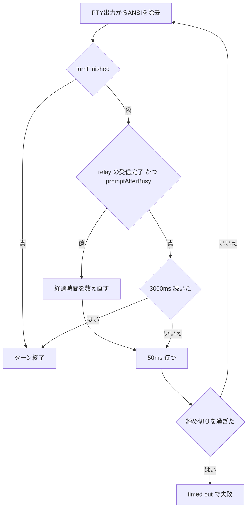

# ターン終了の補助判定と中断の記録の修正 設計

## 結論

二つの不具合を直す。

1. 終了行（`✻ … for Ns`）を取りこぼしたターンを、補助判定で終える。補助判定は「relay が上流の応答を最後まで受け取った（`relay.capture.complete`）」かつ「最後に描かれた入力欄より後ろに応答中の表示（`esc to interrupt`）が無い」状態が、3000ms 途切れずに続くことである。判定は `TuiSession.waitIdle` の中で行い、終了行による従来の判定（`turnFinished`）は変えずに残す。
2. 中断を `stopReason: "aborted"` として記録する。`src/stream.ts:428` の判定に「例外の name が `AbortError`」を加え、セッションの片付け（`closeTuiProcesses`）で止めた要求は `AbortError`（message `Claude Code TUI session was closed`）で返す。加えて、記録の実例（`error`・`This operation was aborted`）を生んでいる `src/provider.ts` の `resolve` の `signal.throwIfAborted()` を削除する。

確定した差分は `examples/src-changes.diff`・`examples/tests-changes.diff`・`examples/fake-claude.diff` にある。3つを一時コピーのリポジトリに `git apply` し、`npm test`（171件合格、変更前151件）と `npm run check` の合格を確認済みである。

## 目的

### 終了行の取りこぼし

`TuiSession.waitIdle` は `turnFinished` だけでターンの終わりを判定する。`turnFinished` は終了行の後ろに入力欄があるときだけ真になるため、差分描画などで終了行が画面のバッファに残らないと、上流の応答がすべて届いていても無応答の打ち切り（`timeoutMs`、Pi からは通常 300000ms）まで待ち、`Claude Code timed out: it did not finish its turn within 300000ms` で失敗する。2026-11-06 の実例では、画面の末尾に入力欄 `❯ ? for shortcuts` があるのに終了行が無かった。終了行が残らなかった原因は特定していない（未確定）。

### 中断が error と記録される

Pi のセッション記録（`~/.pi/agent/sessions`）に、`stopReason: "error"`・`errorMessage: "This operation was aborted"`・`content: []` の応答が残る（2026-11-04 に2件、2026-11-07 に1件）。どれもツールの実行が `Script aborted: This operation was aborted` で中断された直後（14〜20ms 後）に記録されている。実測で確かめた経路は次のとおりである。

1. Pi の `Agent.abort()` が理由なしで `AbortController.abort()` を呼ぶ。signal の reason は `DOMException`（name `AbortError`、message `This operation was aborted`）になる。
2. エージェントのループは中断後も次の応答を要求し、Pi の `ModelRuntime.streamSimple` が `lazyStream` の setup の中で認証を解決する。
3. 本拡張の `src/provider.ts` の `auth.apiKey.resolve` が `signal.throwIfAborted()` で上の `DOMException` を投げる。
4. pi-ai の `lazyStream`（`dist/api/lazy.js` の `createSetupErrorMessage`）は setup の例外を常に `stopReason: "error"` で記録する。`streamClaudeCode` は呼ばれない。

`streamClaudeCode` に中断済みの signal を直接渡すと `aborted` と記録されることも実測した。したがって依頼の `src/stream.ts:428` だけを直しても、記録の実例は直らない。本設計は `provider.ts` の `throwIfAborted` も削除する。

これとは別に、Pi の signal が中断されないまま `closeTuiProcesses`（`registerSessionResourceCleanup` から呼ばれる）が要求を止めると、`streamClaudeCode` に届く例外は `Claude Code ended: <画面>`、`Claude Code exited from signal SIGKILL`、`Claude Code TUI session was closed`（name `Error`）のいずれかになり、どれも `error` と記録される（実測）。これも `aborted` として記録する。

## 範囲

対象:

- `src/tui-screen.ts`: `PROMPT_ALL` と `promptAfterBusy` を追加する
- `src/pty-session.ts`: `TuiSessionOptions.promptFallbackMs`、`FallbackHold`、`promptFallbackReached` を追加し、`waitIdle` に第3引数 `responseComplete` を足す
- `src/tui-process.ts`: `waitIdle` に `() => this.relay.capture.complete` を渡す
- `src/tui-lifecycle.ts`: 片付けの reason を `DOMException`（`AbortError`）にし、片付けで止めた要求の例外をその reason に置き換える
- `src/stream.ts`: `isAbortError` を追加し、428行目の判定に加える
- `src/provider.ts`: `resolve` の `signal.throwIfAborted()` と引数の `signal` を削除する
- `tests/fixtures/fake-claude.mjs`: `FAKE_TURN_LINE`・`FAKE_SPIN_MS`・`FAKE_PROMPT_WHILE_BUSY` を追加する
- `tests/tui-screen.test.ts`、`tests/pty-session.test.ts`、`tests/tui-process.test.ts`、`tests/stream-abort.test.ts`（新規）
- `docs/turn-completion.md`

対象外（変更しない）:

- `turnFinished`・`screenState`・`isBusy`・`TURN_DONE` の判定
- `TuiSession.ready`・`clear` の判定
- 無応答の打ち切りの数え方（最後の上流活動 + `timeoutMs`）と文言
- `src/claude-cli.ts`（`claude -p` 経路）。中断済みの signal では `runClaudeRequest` の先頭の `throwIfAborted` が投げ、`stream.ts` が `aborted` と記録する（既存どおり）
- pi-ai・pi-coding-agent 本体（`lazyStream` が setup の例外を常に error とする挙動）
- 補助判定を使ったことの診断情報（`diagnostics`）への記録
- README.md（利用者が設定する値を増やさないため）

## 変更前と変更後

### ターン終了の判定（`TuiSession.waitIdle`）

| 画面と relay の状態 | 変更前 | 変更後 |
| --- | --- | --- |
| 終了行があり、その後ろに入力欄があり、後ろに応答中の表示が無い | 終了 | 終了（即時。補助判定を待たない） |
| 終了行が無い。relay の受信完了。入力欄が応答中の表示より後ろにある | `timeoutMs` まで待って失敗 | その状態が 3000ms 続いた時点で終了 |
| 終了行が無い。relay の受信完了。応答中の表示が入力欄より後ろにある（スピナー描画中） | `timeoutMs` まで待って失敗 | 待ち続ける（応答中とみなす） |
| 終了行が無い。relay の受信が未完了（要求前・受信中・`message_stop` 前に切断）。入力欄は応答中の表示より後ろにある | `timeoutMs` まで待って失敗 | 変わらない（補助判定は働かない） |
| `responseComplete` を渡さずに `waitIdle` を呼ぶ | 終了行だけで判定 | 変わらない（補助判定は働かない） |

### 中断の記録（`streamClaudeCode` の出力、Pi のセッション記録）

| 状況 | 変更前 | 変更後 |
| --- | --- | --- |
| Pi が中断済みの signal で要求を始める（ツールの中断直後） | `error` / `This operation was aborted`（pi-ai の `lazyStream` が記録） | `aborted` / `This operation was aborted`（`streamClaudeCode` が記録） |
| 要求中に Pi の signal が中断される | `aborted` | `aborted`（変わらない） |
| Pi の signal は生きたまま、起動中（`ready`）にセッションを片付ける | `error` / `Claude Code TUI session was closed` | `aborted` / `Claude Code TUI session was closed` |
| Pi の signal は生きたまま、ターン中（`submit` 以降）にセッションを片付ける | `error` / `Claude Code ended: <画面>` または `Claude Code exited from signal SIGKILL` | `aborted` / `Claude Code TUI session was closed` |
| 中断でない失敗（Claude Code が見つからない、時間切れ、上流の失敗など） | `error` | `error`（変わらない） |

Pi の自動再試行の判定（pi-ai の `isRetryableAssistantError`）は、上の文言を `error`・`aborted` のどちらで渡しても false を返す（実測）。再試行の挙動は変わらない。`src/tool-history.ts` は `error` と `aborted` を同じに扱うので、ツール履歴の修復も変わらない。

## API（関数の契約）

```ts
// src/tui-screen.ts（追加）
export function promptAfterBusy(plain: string): boolean;

// src/pty-session.ts（追加・変更）
export interface TuiSessionOptions {
  // 既存の項目はそのまま
  promptFallbackMs?: number; // 既定 3000
}
export interface FallbackHold { since?: number }
export function promptFallbackReached(hold: FallbackHold, holding: boolean, now: number, holdMs: number): boolean;
class TuiSession {
  // 変更前: waitIdle(timeoutMs: number, lastActivityAt?: () => number): Promise<void>
  waitIdle(timeoutMs: number, lastActivityAt?: () => number, responseComplete?: () => boolean): Promise<void>;
}

// src/tui-lifecycle.ts（シグネチャは変えない。挙動だけ変える）
export async function trackTuiRequest<T>(sessionId, signal, operation): Promise<T>;
export async function abortTuiRequests(sessionId?: string): Promise<void>;

// src/stream.ts（モジュール内の非公開関数を追加）
function isAbortError(error: unknown): boolean;
```

関数ごとの詳しい契約は structure.md に書く。

## 業務ルール

### 補助判定

1. 補助判定は、終了行による判定（`turnFinished`）が偽のときだけ使う。`turnFinished` が真なら、補助判定の状態に関係なく直ちに終える。
2. 補助判定の条件（以下「保持条件」）は次の2つが同時に成り立つことである。
   - `responseComplete()` が `true` を返す。`tui-process.ts` は `this.relay.capture.complete` を返す関数を渡す。`capture.complete` は、HTTP 200 の応答で `message_stop` を受け取り、`stop_reason` があり、未完了の `tool_use` 引数が無いときだけ真になる（`AnthropicCapture` の既存の定義）。
   - `promptAfterBusy(plainScreen(raw))` が真である。最後に描かれた入力欄（`❯` の直後が空白か NBSP）の位置が、最後の `esc to interrupt` の位置より後ろにあるとき真で、入力欄が一度も描かれていなければ偽である。
3. 保持条件が 3000ms（`promptFallbackMs`）途切れずに続いたら、ターンの終わりとみなす。確認は `poll` の 50ms 間隔ごとに行い、一度でも偽になったら経過時間を数え直す。経過時間がちょうど `promptFallbackMs` に達した確認で真とする（`>=`）。
4. 保持条件を満たしていても、締め切り（最後の上流活動 + `timeoutMs`）を過ぎたら従来どおり `Claude Code timed out: it did not finish its turn within <timeoutMs>ms: <画面>` で失敗する。補助判定は締め切りを延ばさない。
5. 補助判定で終えたあとの処理（`relay.settled()`、`assertCompleteCapture`、`/clear`）は、終了行で終えた場合と同じである。
6. 画面のバッファは `submit` が空にし、`capture` は `beginTurn` が作り直す。どちらもターンごとに新しいため、前のターンの入力欄や受信完了で補助判定が働くことはない。

### 中断の記録

7. `streamClaudeCode` は、Pi の signal が中断されているか、例外の name が `AbortError` のとき `stopReason: "aborted"` とし、それ以外は `error` とする。`errorMessage` は既存どおり `normalizeError(error)` である。
8. `abortTuiRequests`（`closeTuiProcesses` が呼ぶ）は、各要求を `new DOMException("Claude Code TUI session was closed", "AbortError")` を reason にして止める。
9. `trackTuiRequest` は、自分の `AbortController` が中断された（片付けで止められた）あとに `operation` が失敗したら、元の例外を捨てて reason（ルール8の `DOMException`）を投げる。Pi の signal だけが中断された場合と、片付けで止められていない場合は、元の例外をそのまま投げる。片付けで止められても `operation` が成功したら、その結果を返す。
10. `provider.ts` の `auth.apiKey.resolve` は signal を見ない。中断済みでも認証情報を返し、中断の記録は `streamClaudeCode` に任せる。

## 設定

- 追加する値は `TuiSessionOptions.promptFallbackMs`（既定 `DEFAULT_PROMPT_FALLBACK_MS = 3_000`）だけである。`tui-process.ts` は指定せず、既定値を使う。テストだけが短い値（300）を指定する。
- 環境変数は追加しない。
- 3000ms の根拠: 終了行がある通常のターンは補助判定を待たないため、この待ち時間は取りこぼしたターンにだけ加わる。300 秒の失敗と比べて十分に短く、上流の受信完了から TUI が入力欄を描き直すまでの時間（`SETTLE_MS` 300ms の10倍）より長い。描き直しにかかる時間の実測値は無い（推測）。

## エラー

- 新しい例外クラスは作らない。片付けの reason は標準の `DOMException`（name `AbortError`）である。Node 24 では `DOMException` は `Error` のインスタンスである（実測）。
- 補助判定は例外を投げない。時間切れの例外と文言は既存の `poll` のままである。
- `isAbortError` は name だけで判定する。Node の `AbortSignal` 由来の例外（`fetch`・`child_process`・`throwIfAborted`）も name が `AbortError` であり、どれも中断として記録してよい。

## ドキュメント

`docs/turn-completion.md` を次の内容に置き換える（未対応の参考指摘と確認結果の節は、既存の内容を残して末尾に置く）。

````markdown
# ターン終了の判定

`src/pty-session.ts` の `waitIdle` は、終了行による判定（`turnFinished`）と、終了行を取りこぼしたときの補助判定でターンの終わりを決める。

## 終了行による判定

`src/tui-screen.ts` の `turnFinished` は、終了行の後ろに入力欄があり、それより後ろに新しい応答中の表示がないことを確認する。

終了行は次の表記を受け付ける。

- `✻ Worked for 12s`（分・時も含む）
- `✻ Crunched for 5m 12s · done 12:12 AM`
- `✻ Crunched for done 12:12 AM`（差分描画で所要時間が残らない場合）

Claude Code 2.1.317 の実行ファイルには終了時刻を追加する表示が存在する。最後の表記はタイムアウト時の画面で観測したもの。所要時間が消えた原因が差分描画かどうかは未確定。

## 補助判定

2026-11-06 に、入力欄は描かれているのに終了行が画面に残らず、300 秒待って失敗したターンがあった。終了行が無いときは、次の2つが 3000ms（`promptFallbackMs`）続いたらターンの終わりとみなす。

- relay が上流の応答を最後まで受け取った（`relay.capture.complete`）
- 最後に描かれた入力欄より後ろに `esc to interrupt` が無い（`promptAfterBusy`）

貼り付けた直後の画面と、応答中の表示の後ろに入力欄が描き直された画面も2つ目の条件を満たす。このため2つ目の条件だけでは終了とみなさず、上流の受信完了と組み合わせる。補助判定は締め切り（最後の上流活動 + `timeoutMs`）を延ばさない。


````

リポジトリに `docs/sync_backlog_wiki.js` は存在しないので、同期は実行しない。

## 受け入れ条件

1. 終了行を描かない偽 claude（`FAKE_TURN_LINE=0`）で `runTuiRequest` が応答 `hello` を返し、`timeoutMs`（10000ms）より前に終わる。
2. 応答中（スピナーの描き直し中、または応答中の表示の後ろに入力欄がある画面）は、受信完了の前に終了とみなさない（test-list.md の反例がすべて合格する）。
3. `message_stop` が届かない応答では、終了行が無く入力欄が出ていても補助判定で終えず、`timed out` で失敗する。
4. 終了行がある通常のターンは、補助判定の待ち時間を待たずに終わる。
5. 中断済みの signal で、pi-ai の `lazyStream` を通して要求を始めると `stopReason: "aborted"`・`errorMessage: "This operation was aborted"` になる。
6. Pi の signal が生きたままセッションを片付けると、起動中・ターン中のどちらでも `stopReason: "aborted"`・`errorMessage: "Claude Code TUI session was closed"` になる。
7. 中断でない失敗は `stopReason: "error"` のままである。
8. 既存のテストを変更せずに合格する（`tests/tui-process.test.ts` の既存のセッション破棄のテスト2件を含む）。
9. `npm test` が全件合格し、`npm run check` が合格する。

## 未決事項

- 終了行が画面に残らなかった原因（差分描画か、PTY の読み取りか、`SCREEN_KEEP` の切り詰めか）は特定していない。補助判定は原因に関係なく働くが、原因の調査は本依頼の範囲外とする。
- 3000ms は実機で測っていない。受信完了のあと TUI が入力欄を描き直すまでに 3000ms を超える実例が見つかったら、値を見直す。
- 受信完了のあとに、Claude Code が `❯` で始まる選択肢（例: `❯ 1. Yes`）を描いて利用者の入力を待つ画面も `promptAfterBusy` を満たす。本拡張は `--allowedTools mcp__pi` で許可の確認を出さない設定にしているため、今回は区別しない。
- 補助判定で終えたターンを診断情報（`claude-code.turn-relay`）に記録するかは、依頼に無いため今回は記録しない。
- `claude-jev-router`（利用者の拡張）は、直前の実装担当の応答が `stopReason: "error"` のときに計画担当へ切り替える。中断が `aborted` と記録されると、中断の直後はこの切り替えが起きなくなる。拡張側の変更は範囲外とする。
- pi-ai の `lazyStream` が setup の例外を常に `error` と記録する挙動は、本拡張以外のプロバイダーでも起こりうる。pi 本体への報告は範囲外とする。
