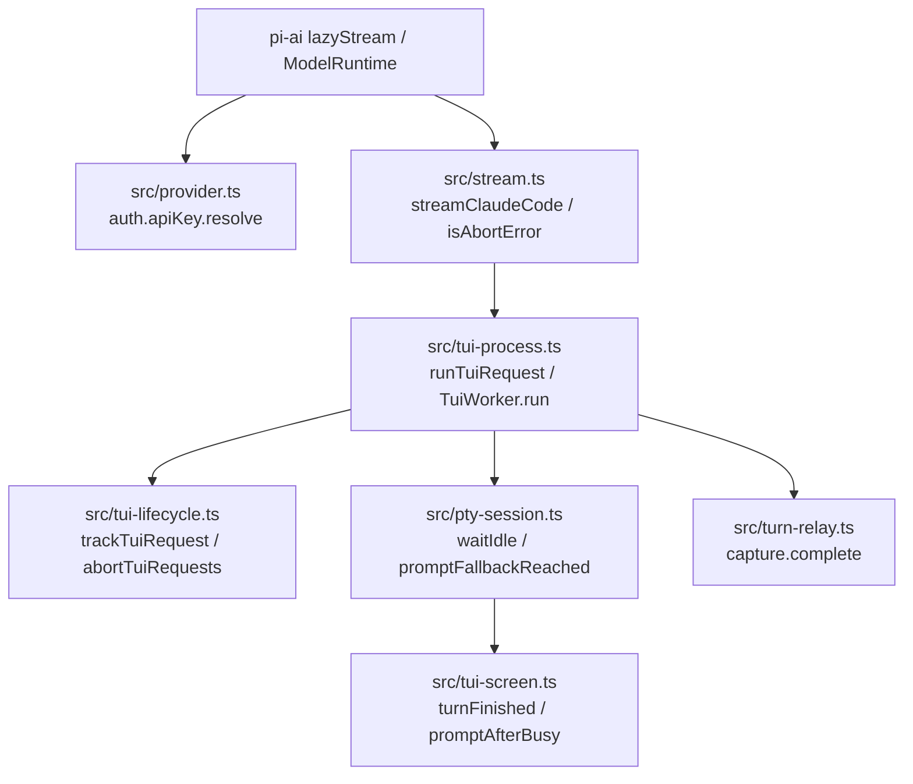

# 構成

## 結論

新規ファイルは `tests/stream-abort.test.ts` だけである。補助判定は「画面の判定（`tui-screen.ts` の純粋関数 `promptAfterBusy`）」「時間の判定（`pty-session.ts` の純粋関数 `promptFallbackReached`）」「受信完了の取得（`tui-process.ts` が渡す関数）」の3つに分け、組み合わせは `TuiSession.waitIdle` の1か所だけで行う。中断かどうかの判定は `stream.ts` の `isAbortError` の1か所に集め、片付けで止めた要求を中断の例外に変えるのは `trackTuiRequest` の1か所だけで行う。

お手本（一時コピーのリポジトリで3つの diff を当て、`npm test` 171件合格・`npm run check` 合格を確認済み。`git apply --check` も本リポジトリで確認済み）:

| お手本 | 使い方 |
| --- | --- |
| `examples/fake-claude.diff` | `tests/fixtures/fake-claude.mjs` の確定差分。最初に当てる |
| `examples/src-changes.diff` | `src/tui-screen.ts`・`src/pty-session.ts`・`src/tui-process.ts`・`src/tui-lifecycle.ts`・`src/stream.ts`・`src/provider.ts` の確定差分 |
| `examples/tests-changes.diff` | `tests/tui-screen.test.ts`・`tests/pty-session.test.ts`・`tests/tui-process.test.ts` の追加と `tests/stream-abort.test.ts` の新規作成の確定差分 |
| `examples/prompt-after-busy.ts` | `promptAfterBusy` の部分だけを抜き出したもの。`src-changes.diff` の `tui-screen.ts` 部分と同一 |
| `examples/prompt-after-busy.test.ts` | `promptAfterBusy` のテストだけを抜き出したもの。`tests-changes.diff` の `tui-screen.test.ts` 部分と同一 |

当てる順序: `git apply docs/devflow/20261107-1148/examples/fake-claude.diff`、次にテスト（`tests-changes.diff`）、最後に本体（`src-changes.diff`）。TDD の Red の確かめ方は test-list.md に書く。お手本は完成形であり、本体の差分は Red を確かめたあとに当てる。

## 層と依存の向き



- `tui-screen.ts` は葉のモジュールのままである。時間も relay も知らない。
- `pty-session.ts` は relay を import しない。受信完了は `waitIdle` の引数の関数 `responseComplete` として受け取る。
- `tui-process.ts` だけが relay と TuiSession の両方を知り、`() => this.relay.capture.complete` を渡す。
- `stream.ts` は `tui-lifecycle.ts` を import しない。片付けの例外は name `AbortError` という形だけで受け取る。
- `turn-relay.ts` は変更しない。

## 型と関数

### `src/tui-screen.ts`

```ts
// PROMPT の定義の直後に置く
const PROMPT_ALL = /❯[ \u00a0]/g;

// turnFinished の直後、bracketedPaste の前に置く
export function promptAfterBusy(plain: string): boolean {
  const prompt = lastMatchIndex(PROMPT_ALL, plain);
  return prompt >= 0 && prompt > plain.lastIndexOf(BUSY_MARK);
}
```

- `PROMPT`（g なし）は `.test` 用に残す。`lastMatchIndex` は `matchAll` を使うため g 付きが要る。
- `BUSY_MARK` が無いとき `lastIndexOf` は -1 なので、入力欄が1つでもあれば真になる。

### `src/pty-session.ts`

```ts
export interface TuiSessionOptions {
  // 既存: command, args, cwd, env, listedMarker, trustFolder, readyTimeoutMs
  /** 終了行を取りこぼしたとき、応答の受信完了と入力欄がこの時間続いたらターンの終わりとみなす */
  promptFallbackMs?: number;
}

// SCREEN_KEEP の直後に置く
const DEFAULT_PROMPT_FALLBACK_MS = 3_000;

// sleep の直後、class TuiSession の前に置く
export interface FallbackHold {
  since?: number;
}

/** holding が途切れずに holdMs 続いたら真。途切れたら数え直す */
export function promptFallbackReached(hold: FallbackHold, holding: boolean, now: number, holdMs: number): boolean {
  if (!holding) {
    hold.since = undefined;
    return false;
  }
  hold.since ??= now;
  return now - hold.since >= holdMs;
}
```

`waitIdle` の変更後（JSDoc コメントは既存のまま残す）:

```ts
async waitIdle(timeoutMs: number, lastActivityAt?: () => number, responseComplete?: () => boolean): Promise<void> {
  const hold: FallbackHold = {};
  const holdMs = this.options.promptFallbackMs ?? DEFAULT_PROMPT_FALLBACK_MS;
  await this.poll(timeoutMs, () => "Claude Code timed out: it did not finish its turn", () => {
    const plain = plainScreen(this.raw);
    if (turnFinished(plain)) return true;
    return promptFallbackReached(hold, responseComplete?.() === true && promptAfterBusy(plain), Date.now(), holdMs);
  }, undefined, lastActivityAt);
}
```

- `since` の「未開始」は `undefined` で表す。0 を番兵にすると、テストで `now = 0` を渡したときに開始時刻が記録されない。
- `promptFallbackReached` は `hold` を書き換える。`hold` は `waitIdle` の呼び出しごとに新しく作り、インスタンスのフィールドにしない（ターンをまたいで持ち越さないため）。
- `responseComplete` を省略した呼び出しは `holding` が常に偽になり、変更前と同じ挙動になる。
- `import` に `promptAfterBusy` を加える（`plainScreen` の後ろ、アルファベット順）。

### `src/tui-process.ts`

`TuiWorker.run` の1行だけを変える。

```ts
await this.session.waitIdle(input.timeoutMs ?? DEFAULT_TIMEOUT_MS, () => this.relay.lastActivityAt, () => this.relay.capture.complete);
```

- `this.relay.capture` は `beginTurn` が作り直すので、関数の中で毎回 `this.relay.capture` を読む（変数に取り出して保持しない）。

### `src/tui-lifecycle.ts`

```ts
// trackTuiRequest の try に catch を加える
  try {
    const combined = signal ? AbortSignal.any([signal, controller.signal]) : controller.signal;
    combined.throwIfAborted();
    return await operation(combined);
  } catch (error) {
    // 片付けで止めた要求は、途中で出た「Claude Code ended」などではなく中断として返す
    if (controller.signal.aborted) throw controller.signal.reason;
    throw error;
  } finally {
    pending.delete(request);
    completion.resolve();
  }

// abortTuiRequests の reason を変える
for (const request of targets) request.controller.abort(new DOMException("Claude Code TUI session was closed", "AbortError"));
```

### `src/stream.ts`

```ts
// normalizeError の直前に置く
// Pi の signal 以外（セッションの片付け）で止めた要求も、失敗ではなく中断として記録する
function isAbortError(error: unknown): boolean {
  return error instanceof Error && error.name === "AbortError";
}

// 428行目（catch の先頭）
output.stopReason = options?.signal?.aborted || isAbortError(error) ? "aborted" : "error";
```

- `isAbortError` は export しない（テストは `streamClaudeCode` の結果で確かめる）。

### `src/provider.ts`

```ts
        // 中断済みの signal で投げると、pi-ai の lazyStream が stopReason "error" として記録する。
        // 投げずに返し、streamClaudeCode に中断として記録させる
        async resolve({ ctx: context }) {
          const providerEnv = await providerEnvironment(context);
          // 以降は既存のまま
```

- 引数の分割代入から `signal` を外す（未使用の変数を残さない）。`check` と `oauth.refresh` の signal はそのまま使う。

### `tests/fixtures/fake-claude.mjs`

`examples/fake-claude.diff` のとおりに3つの環境変数を足す。

| 変数 | 意味 |
| --- | --- |
| `FAKE_TURN_LINE=0` | 貼り付けたターンの終わりに終了行 `✻ Worked for 0s` を描かない。`/clear` の終わりには描く |
| `FAKE_SPIN_MS=<ms>` | 応答中、この間隔で `\x1b[1G<記号> <番号>` を描く。入力欄もヒント行も描き直さない |
| `FAKE_PROMPT_WHILE_BUSY=1` | 応答中の表示 `✻ Thinking… (esc to interrupt)` の直後に入力欄を描く |

## 例外の扱い

- 中断の記録への変換（`stopReason` の決定）は `stream.ts` の catch の1か所だけで行う。`tui-process.ts` と `pty-session.ts` は `stopReason` を知らない。
- 片付けの例外への置き換えは `trackTuiRequest` の catch の1か所だけで行う。`TuiWorker.run`・`runTrackedRequest`・`poll` には中断の判定を足さない。
- 新たな `try/catch` は `trackTuiRequest` の catch の1つだけである。
- 補助判定は例外を投げない。時間切れは既存の `poll` が投げる。

## 状態の持ち方

| 値 | 保存 / 導出 | 置き場所と寿命 |
| --- | --- | --- |
| 保持条件が成り立ち始めた時刻 `since` | 保存 | `waitIdle` のローカル変数 `hold`。1回の `waitIdle` の間だけ |
| 保持条件が成り立つか | 導出（毎回の確認で計算） | `waitIdle` の判定関数 |
| 受信完了 | 導出（`relay.capture.complete` を毎回読む） | `TurnRelay`（既存。`beginTurn` でターンごとに作り直す） |
| 入力欄が応答中の表示より後ろか | 導出 | `promptAfterBusy` |
| 片付けで止められたか | 保存（`controller.signal.aborted`） | `trackTuiRequest` の `AbortController`。1要求の間だけ |
| `stopReason` | 導出 | `streamClaudeCode` の catch |

## 同時実行と古い応答

- `poll` は 50ms ごとに同期的に判定する。`hold` は1つの `waitIdle` だけが触るため、ロックは不要である。
- 前のターンの状態は持ち越さない。`submit` が `raw` を空にし、`beginTurn` が `capture` を作り直し、`waitIdle` が `hold` を作り直す。
- 同じセッションへの並行要求は、既存どおり別の `TuiWorker`（別の TUI と relay）で受ける。補助判定の状態は worker ごとに独立している。
- 補助判定で終えたあとに Claude Code が送る回復要求は、既存どおり relay が `finishTurn` 後に `PI_CLAUDE_CODE_TURN_RELAY_CONSUMED` で拒否する。
- 片付けと要求の成功が競合した場合、`operation` が成功していれば結果を返す（`catch` に入らないため）。失敗していれば片付けの例外を返す。
- 片付けの `closeTuiProcesses` は既存どおり、止めた要求の終了（`done`）を待ってから戻る。

## テストの配置と書き方

- テストは `node:test` の `test` と `node:assert/strict` を使い、テスト名は日本語で書く（既存のテストと同じ）。
- 画面の判定は `tests/tui-screen.test.ts`、時間の判定と `waitIdle` は `tests/pty-session.test.ts`、relay と組み合わせた判定は `tests/tui-process.test.ts`、中断の記録は新規 `tests/stream-abort.test.ts` に置く。
- `tests/pty-session.test.ts` の補助判定のテストは `promptFallbackMs: 300` を指定する。`tests/tui-process.test.ts` は既定の 3000ms のまま使う（`tui-process.ts` が値を渡さないため）。
- `tests/stream-abort.test.ts` の片付けのテストは、`TuiSession.prototype.ready` または `submit` を `mock.method` で止めてから `closeTuiProcesses` を呼ぶ。`streamClaudeCode` は `upstreamUrl` を渡さないため、貼り付けが TUI に届くと偽 claude が relay 経由で本物の API へ要求を出す。`submit` の元の実装は片付けのあとにしか呼ばれないので、要求は出ない。
- `lazyStream` と `normalizeContext` は `@earendil-works/pi-ai` から import する（Pi と同じ経路を再現するため。自前で書き直さない）。

## 規模の目安

| ファイル | 変更前 | 変更後 | 判定 |
| --- | --- | --- | --- |
| `src/tui-screen.ts` | 71 | 81 | 300以内 |
| `src/pty-session.ts` | 185 | 209 | 300以内 |
| `src/tui-lifecycle.ts` | 33 | 37 | 300以内 |
| `src/stream.ts` | 440 | 445 | 300超は変更前からである。本依頼では分割しない |
| `tests/tui-screen.test.ts` | 87 | 123 | 300以内 |
| `tests/pty-session.test.ts` | 143 | 223 | 300以内 |
| `tests/tui-process.test.ts` | 281 | 299 | 300以内。これ以上足さない |
| `tests/stream-abort.test.ts` | 新規 | 79 | 300以内 |

- 追加する関数はすべて10行以内、分岐は最大2である。`waitIdle` は9行になる。
- `tests/tui-process.test.ts` が 300 行に近いため、ターン中の片付けのテストは `tests/stream-abort.test.ts` に置く。
