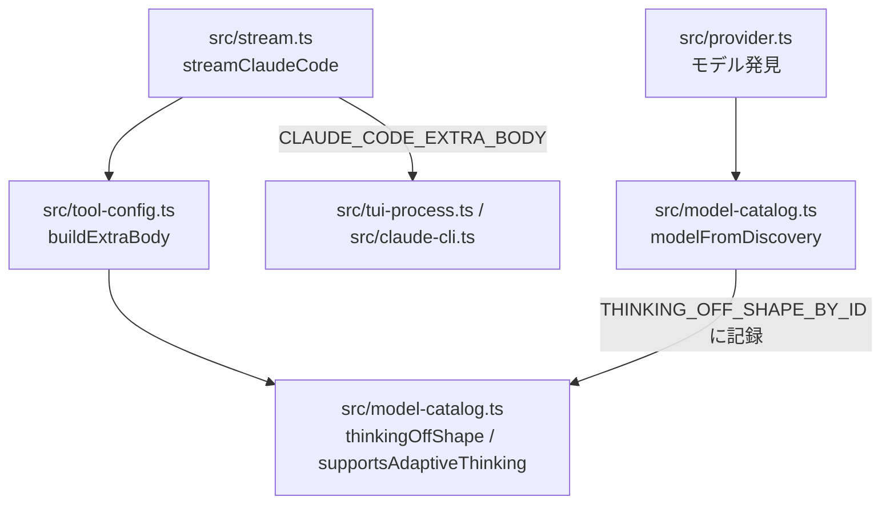

# 構成: モデルごとの thinking オフの形

## 結論

新規ファイルは無い。形の判定は `src/model-catalog.ts` の公開関数 `thinkingOffShape` の1か所に集め、`src/tool-config.ts` の `buildExtraBody` はその戻り値を `thinking.type` に入れるだけにする。表の持ち方は既存の `ADAPTIVE_THINKING_BY_ID` と `supportsAdaptiveThinking` に合わせる。

お手本（一時コピーのリポジトリで両方を当て、`npm test` 177件合格・`npm run check` 合格を確認済み。`git apply --check` も本リポジトリで確認済み）:

| お手本 | 使い方 |
| --- | --- |
| `examples/tests-changes.diff` | `tests/model-catalog.test.ts` と `tests/transcript.test.ts` の確定差分。先に当てる |
| `examples/src-changes.diff` | `src/model-catalog.ts` と `src/tool-config.ts` の確定差分。Red を確かめたあとに当てる |
| `examples/probe-thinking-off.mts` | 実機に thinking オフの本文を1回送る確認用スクリプト。受け入れ条件3で `current` モードを使う。リポジトリの本体やテストには入れない |
| `examples/probe-results.jsonl` | 設計時の実機の結果（7行）。根拠として残すだけで、実装では使わない |

## 層と依存の向き



依存は `tool-config.ts` から `model-catalog.ts` への一方向だけである。`model-catalog.ts` は `tool-config.ts` を import しない。`stream.ts`・`tui-process.ts`・`claude-cli.ts`・`provider.ts` は変えない。

## 型

`src/model-catalog.ts` の `ClaudeCodeModel` の直後に置く。

```ts
/** The `thinking.type` value that turns thinking off for a model. */
export type ThinkingOffShape = "disabled" | "between_tools";
```

`DiscoveredClaudeModel` には項目を足さない（Claude Code の `supportsThinkingOff` は全モデル `false` であり、形を判定する情報にならないため）。

## `src/model-catalog.ts` の変更

| 名前 | 公開 | 置き場所 | 中身 |
| --- | --- | --- | --- |
| `THINKING_OFF_SHAPE_BY_ID` | しない | `ADAPTIVE_THINKING_BY_ID` の直後 | `new Map<string, ThinkingOffShape>()`。キーは Pi のモデル ID（`modelFromDiscovery` の `id`。`default` を含む） |
| `BETWEEN_TOOLS_THINKING_OFF_IDS` | しない | `THINKING_OFF_SHAPE_BY_ID` の直後 | `ReadonlySet<string>`。中身は `"claude-sonnet-5-5"` の1件だけ。直前に「なぜ」のコメント2行（実測日・400 の内容、`supportsThinkingOff` で判定できない理由）を置く |
| `thinkingOffShapeOf(resolvedId: string): ThinkingOffShape` | しない | `withoutContextSuffix` の直後 | 集合に完全一致で含まれれば `"between_tools"`、それ以外は `"disabled"`。引数は接尾辞と別名を外した ID である前提とし、関数の中では正規化しない |
| `modelFromDiscovery` | 既存 | 既存 | `ADAPTIVE_THINKING_BY_ID.set(...)` の直後に `THINKING_OFF_SHAPE_BY_ID.set(id, thinkingOffShapeOf(builtinId));` を1行足す。`builtinId` は既存の変数（`default` なら `resolvedModel` から `[1m]` を外した値、無ければ空文字。それ以外は `id`） |
| `thinkingOffShape(model: string): ThinkingOffShape` | する | `supportsAdaptiveThinking` の直後 | `const canonical = canonicalRoute(model);` のあと `THINKING_OFF_SHAPE_BY_ID.get(model) ?? THINKING_OFF_SHAPE_BY_ID.get(canonical) ?? thinkingOffShapeOf(canonical)` を返す |

`thinkingOffShape` の引き方は `supportsAdaptiveThinking` と同じ順（そのままの ID、正規の ID）にする。違いは表に無いときの既定値だけで、`supportsAdaptiveThinking` は `true`、`thinkingOffShape` は `thinkingOffShapeOf(canonical)` を返す。これにより発見を経ていない `claude-sonnet-5-5` と `claude-sonnet-5-5[1m]` も `"between_tools"` になる。

## `src/tool-config.ts` の変更

1. import を `import { supportsAdaptiveThinking, thinkingOffShape } from "./model-catalog.ts";` にする。
2. `buildExtraBody` の `else` 分岐を次の3行にする。英語のコメント `// Native clear-thinking edits are invalid when thinking is disabled.` は次の日本語コメントに置き換える。

```ts
    body.thinking = { type: thinkingOffShape(modelId) };
    // Claude Code 既定の clear-thinking の edits は thinking オフでは無効になるため空で上書きする。between_tools でも edits: [] が通ることを 2026-11-07 に実機で確認した
    body.context_management = { edits: [] };
```

`if (options?.reasoning)` の分岐、`tools`・`max_tokens` の扱い、関数の引数と戻り値の型は変えない。`buildExtraBody` は変更後も約20行で、50行の上限に収まる。

## 例外の扱い

`thinkingOffShape` と `thinkingOffShapeOf` は例外を投げない純粋な判定である（`thinkingOffShape` は表を読むだけで書かない）。API の 400 は今と同じく Claude Code の応答として `stream.ts` 以降の既存の経路で Pi にエラーとして返る。業務エラーへの変換は足さない。

## 状態の持ち方

| 値 | 保存か導出か | 書く場所 | 読む場所 |
| --- | --- | --- | --- |
| `BETWEEN_TOOLS_THINKING_OFF_IDS` | 定数（実測した事実） | ソースの定数 | `thinkingOffShapeOf` |
| `THINKING_OFF_SHAPE_BY_ID` | 保存（モジュール内の Map） | `modelFromDiscovery` だけ | `thinkingOffShape` だけ |
| 1回の要求の `thinking.type` | 導出（呼ぶたびに計算） | `buildExtraBody` | 呼び出し元（`stream.ts`） |

Map に記録するのは `default` が何に解決したかを覚えるためである。`default` という ID だけでは解決先が分からず、`resolvedModel` は発見の時点にしか手に入らない。

## 同時実行と古い応答

`modelFromDiscovery` は発見のたびに同じキーを上書きする。複数の発見が前後した場合は最後に呼ばれた結果が残り、これは `ADAPTIVE_THINKING_BY_ID`・`NATIVE_ROUTE_BY_ID` と同じ挙動である。Node の単一スレッドで `Map.set` と `Map.get` が割り込まれることは無いため、ロックは要らない。要求の途中で発見が走っても、`buildExtraBody` は要求の組み立て時に1回だけ読むため、1つの要求の中で形が混ざることは無い。トランザクションと保存データは無い。

## 分割と行数

| ファイル | 変更前 | 変更後（確定差分を当てた行数） |
| --- | --- | --- |
| `src/model-catalog.ts` | 181行 | 199行 |
| `src/tool-config.ts` | 116行 | 116行 |

どちらも本体500行の目安に収まり、新しい関数はすべて5行以下である。ファイルは分けない（thinking オフの形はモデルの性質であり、`supportsAdaptiveThinking` と同じファイルに置くのが既存の分け方に合うため）。

## テストの置き場所

- `thinkingOffShape` のテストは `tests/model-catalog.test.ts` の末尾に足す。import に `thinkingOffShape` を足す。
- `buildExtraBody` のテストは `tests/transcript.test.ts` の既存テスト「buildExtraBody keeps thinking disabled without display when reasoning is absent」の直後に4件足す（既存の `buildExtraBody` のテストが `transcript.ts` の再 export 経由でこのファイルにあるため）。
- テスト名は両ファイルの既存に合わせて英語で書く。
- `modelFromDiscovery` はモジュール内の Map を書き換えるため、`default` を書き換えるテストは最後に `resolvedModel: "claude-opus-5-5[1m]"`（`FALLBACK_DISCOVERY` と同じ値）で呼び直し、後続のテストに影響を残さない。
