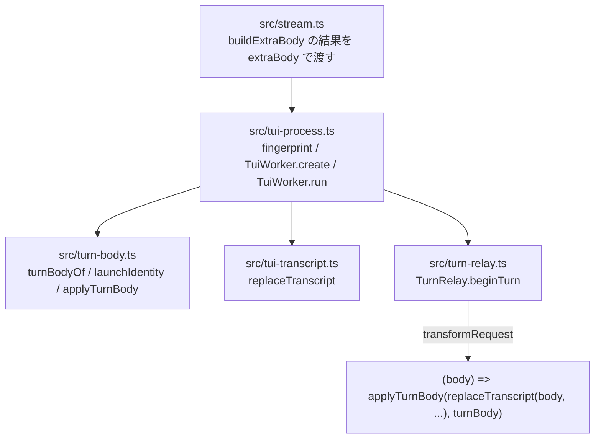
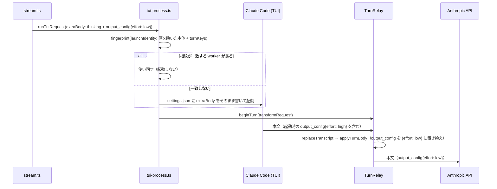

# 構成: ターンごとに本文へ書くキー（turn-body）

## 結論

新規ファイルは本体の `src/turn-body.ts` 1つである。「どのキーをターンごとに書くか」「指紋に何を残すか」「本文へどう書くか」の判定をこのファイルの純粋関数3つに集め、`src/tui-process.ts` は指紋と `transformRequest` からそれを呼ぶだけにする。`src/turn-relay.ts` と `src/tui-transcript.ts` は変えない。

お手本（一時コピーのリポジトリで両方を当て、`npm test` 199件合格・`npm run check` 合格を確認済み。本リポジトリで `git apply --check` も合格）:

| お手本 | 使い方 |
| --- | --- |
| `examples/tests-changes.diff` | `tests/turn-body.test.ts`（新規）、`tests/tui-process.test.ts`、`tests/fixtures/fake-claude.mjs` の確定差分。先に当てる |
| `examples/src-changes.diff` | `src/turn-body.ts`（新規）と `src/tui-process.ts` の確定差分。Red を確かめたあとに当てる |
| `examples/turn-body.ts`・`examples/turn-body.test.ts` | 上の差分の新規ファイルと同じ中身（読みやすさのために単独で置く） |
| `examples/verify-turn-body.mts` | 実機の検証スクリプト。`scripts/verify-turn-body.mts` にそのまま置く |

## 層と依存の向き



依存は `tui-process.ts` から `turn-body.ts` への一方向だけである。`turn-body.ts` は何も import しない（Node の `structuredClone` と `Buffer` だけを使う）。`turn-relay.ts` は `turn-body.ts` を知らず、今までどおり `transformRequest` を1つ受け取るだけである。

## 1ターンの流れ



## 型

`src/turn-body.ts` に置く。名前と形は次のとおりにする。

```ts
export const TURN_BODY_KEYS = ["output_config", "context_management"] as const;
export type TurnBodyKey = (typeof TURN_BODY_KEYS)[number];
export type TurnBody = Partial<Record<TurnBodyKey, unknown>>;
export interface LaunchIdentity {
  body: Record<string, unknown>;
  turnKeys: TurnBodyKey[];
}
```

## `src/turn-body.ts` の関数

| 関数 | 中身 |
| --- | --- |
| `turnBodyOf(extraBody: Record<string, unknown>): TurnBody` | `TURN_BODY_KEYS` の順に、`extraBody[key] !== undefined` のキーだけを `structuredClone` した値で入れた新しいオブジェクトを返す |
| `launchIdentity(extraBody: Record<string, unknown>): LaunchIdentity` | `body` は `{ ...extraBody }` から `TURN_BODY_KEYS` を `delete` したもの。`turnKeys` は `TURN_BODY_KEYS.filter((key) => extraBody[key] !== undefined)`。引数は書き換えない |
| `applyTurnBody(body: Buffer, turn: TurnBody): Buffer` | `Object.entries(turn)` が空なら `body` をそのまま返す（解析しない）。そうでなければ `JSON.parse` し、結果が null・配列・オブジェクト以外なら `Error("Claude Code request body must be a JSON object")` を投げる。各エントリについて `Object.hasOwn(payload, key)` のときだけ `payload[key] = structuredClone(value)` とし、`Buffer.from(JSON.stringify(payload))` を返す |

コメントはお手本のとおり「なぜ」だけを書く（起動時にしか読まれないこと、キーの有無を指紋に残す理由、本文に無いキーを足さない理由）。お手本の文言を変えない。

## `src/tui-process.ts` の変更

1. import を1行足す: `import { applyTurnBody, launchIdentity, turnBodyOf } from "./turn-body.ts";`（`./tui-lifecycle.ts` の import の直後）。
2. `fingerprint` の先頭で `const launch = launchIdentity(input.extraBody);` を作り、`material` の `extraBody: input.extraBody` を `extraBody: launch.body, turnBodyKeys: launch.turnKeys` に置き換える。`material` のほかのキーと順序は変えない。
3. `TuiWorker.create` の `await Promise.all([` の直前にコメント2行を足す（お手本のとおり）。`writeFile(paths.settings, ...)` の中身は変えない。
4. `TuiWorker.run` で `pinned` の直後に `const turnBody = turnBodyOf(input.extraBody);` を置き、`beginTurn` の第2引数を `(body) => applyTurnBody(replaceTranscript(body, input.frames, input.systemPrompt, input.nativeSystemInjections, pinned), turnBody)` にする。

`turnBodyOf` を `transformRequest` の外で1回だけ呼ぶのは、Claude Code の要求が届く前に `input.extraBody` を写し取り、呼び出し元がターンの途中でオブジェクトを書き換えても送る値が変わらないようにするためである。

## 例外の扱い

業務エラーへの変換は足さない。`applyTurnBody` の例外は `TurnRelay.handle` の既存の `catch` の1か所で `relayFailure("request", error)` に変換され、TUI へ 502 が返る。その後のターンの失敗は `assertCompleteCapture` → `incompleteUpstreamMessage` の既存の経路で Pi に届く。`turn-body.ts` の中では `try/catch` を書かない。

## 状態の持ち方

| 値 | 保存か導出か | どこで作るか | 寿命 |
| --- | --- | --- | --- |
| settings.json の `CLAUDE_CODE_EXTRA_BODY` | 保存（一時ディレクトリのファイル） | `TuiWorker.create` | worker と同じ。起動したターンの値のまま変えない |
| worker の指紋 | 導出（`launchIdentity` を含む材料の sha256） | `acquire` → `fingerprint` | worker に `readonly fingerprint` として保存（既存） |
| ターンの `TurnBody` | 導出（`turnBodyOf(input.extraBody)`） | `TuiWorker.run` の呼び出しごと | 1ターン。`transformRequest` の閉包にだけ入り、worker と relay のフィールドには入れない |

ターンの値を worker に保存しないため、前のターンの effort が次のターンに漏れることは構造上起きない。`TurnRelay.beginTurn` は毎ターン `transformRequest` を差し替える（既存）。

## 同時実行と古い応答

- 同じセッションへの並行要求は、既存の `acquire` が2本目を使い捨ての worker で受ける。各 worker の relay は自分の `transformRequest` を持つため、effort が混ざらない（テスト「同時実行: …」）。
- Claude Code がターンの後に続けて送る回復要求は、既存どおり relay が 400 で拒否し、`transformRequest` を通らない。
- 中断・時間切れ・`/clear` 失敗で壊れた worker は既存どおり再利用しない。ターンの値を保存しないため、後片付けの追加は無い。
- ロックは要らない。`TuiWorker.run` は `busy` の worker でしか動かず、`transformRequest` は1ターンに1回だけ呼ばれる。

## 分割と行数

| ファイル | 変更前 | 変更後（確定差分を当てた行数） |
| --- | --- | --- |
| `src/tui-process.ts` | 251行 | 256行 |
| `src/turn-body.ts` | なし | 44行 |

新しい関数はすべて15行以下で、50行の上限に収まる。`turn-body.ts` を `tui-transcript.ts` に混ぜないのは、`tui-transcript.ts` が `messages` の置き換え（会話の復元）を受け持ち、`turn-body.ts` は生成設定のキーを受け持つという関心の違いのためである。`applyTurnBody` は `replaceTranscript` の結果をもう一度 `JSON.parse` するが、ターンに1回であり、引数を増やして `replaceTranscript` に混ぜるより責務を分けることを優先する。

## テストの置き場所と書き方

- `tests/turn-body.test.ts`（新規）: `turn-body.ts` の純粋関数の単体テスト13件。テスト名は `tests/tui-process.test.ts` と同じく日本語で書く。
- `tests/tui-process.test.ts`: 末尾に9件足す。既存の `withFixture`・`fakeUpstream` をそのまま使い、ヘルパー `thinkingOn(effort)` と `sentKeys(body)` を末尾のテストの直前に置く。
- `tests/fixtures/fake-claude.mjs`: `--settings` のファイルから `CLAUDE_CODE_EXTRA_BODY` を読み、本文の最上位へ `...extraBody` で浅く混ぜる（本物の挙動のまね）。`FAKE_SETTINGS_LOG` が指定されたら起動時に `CLAUDE_CODE_EXTRA_BODY` の文字列を JSON で1行書く。`FAKE_DROP_BODY_KEYS`（カンマ区切り）のキーは混ぜた後に本文から消す。既存のテストは `extraBody: {}` なので、混ぜても本文は変わらない。

## 実機の検証スクリプト（`scripts/verify-turn-body.mts`）

| 部品 | 役割 |
| --- | --- |
| `startProxy` | 127.0.0.1 の HTTP で受け、`https://api.anthropic.com` へそのまま転送する。要求ごとに `anthropic-beta` の集合（重複を除いて並べ替え）と本文の5つのキーを記録する。`TurnRelay` の上流は HTTPS か loopback の HTTP に限られるため、この形にする |
| `descendantSettingsPaths` | `ps -eo pid=,ppid=,args=` からこのスクリプトの子孫だけを選び、`--settings` の一時パスを集める。パスが同じなら同じ claude のプロセスである。利用者が別に動かしている Pi の claude を数えないために子孫に絞る |
| `run` | 引数のリポジトリの根から `src/tui-process.ts` と `src/tool-config.ts` を動的に読み込み、同じ `sessionId`・同じ cwd（`<tmpdir>/pi-verify-turn-body`）で4ターンを送る。`extraBody` は `buildExtraBody(model, [], options)`（`maxTokens` は渡さない。Claude Code 自身の `max_tokens` が変わらないことも比べるため）。会話は前のターンの応答の text ブロックを assistant として積み増す。1ターンでも失敗したら残りを送らずに止める |
| `compare` | 2つの JSONL をターンごとに比べ、`PASS`/`FAIL` の行と `summary` を出す。1つでも `FAIL` なら終了コード 1 |

スクリプトは `tsconfig.json` の `include`（`src`・`tests`）の外なので `npm run check` の対象にならない。設計時に一時的に `tests/` へ置いて `tsc --noEmit` が通ることを確認した。実装担当はお手本を変えずに置く。
