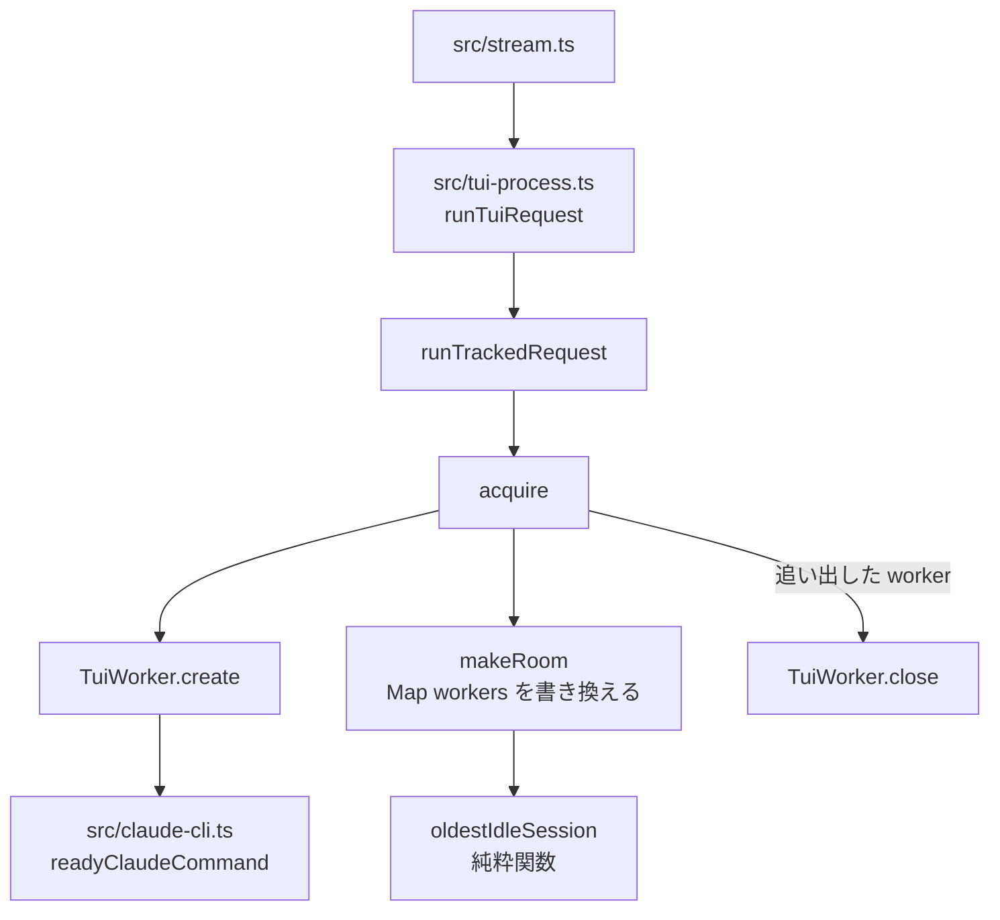

# 構成: TUI の worker キャッシュの追い出し

## 結論

新規ファイルは無い。追い出す相手の選び方は `src/tui-process.ts` の純粋関数 `oldestIdleSession` の1か所に集め、Map を書き換える処理は内部関数 `makeRoom` に置く。`acquire` は `TuiWorker.create` の後、`await` を挟まずに `makeRoom` と登録を行い、その後で追い出した worker を閉じる。開発依存の更新とコメントの修正は、本体の構成を変えない。

お手本（一時コピーのリポジトリで全部を当て、`npm ci --include=dev` の後に `npm test` 210件合格・`npm run check` 合格を確認済み。4つの diff は本リポジトリで `git apply --check` も通る）:

| お手本 | 使い方 |
| --- | --- |
| `examples/tests-changes.diff` | `tests/tui-process.test.ts`（10件）と `tests/package-metadata.test.ts`（1件）の確定差分。先に当てる |
| `examples/src-changes.diff` | `src/tui-process.ts` と `src/claude-cli.ts` の確定差分。Red を確かめた後に当てる |
| `examples/package-changes.diff` | `package.json` の確定差分 |
| `examples/package-lock.json` | 1.5.0 で解決した `package-lock.json`。リポジトリ直下へそのまま複写する |
| `examples/readme-changes.diff` | `README.md` の確定差分 |

## 層と依存の向き



依存の向きは今と同じである。`oldestIdleSession` は `TuiWorker` にも Map にも依存しない（引数の反復だけを読む）。`makeRoom` はモジュールの `workers` と `MAX_CACHED` を読み書きするが、worker を閉じない。閉じるのは `acquire` だけである。`src/claude-cli.ts` の import・export は変えない。

## 状態の持ち方

| 値 | 置き場所 | 種類 |
| --- | --- | --- |
| `workers: Map<string, TuiWorker>` | `src/tui-process.ts` のモジュール変数（今のまま） | 保存する値。キーは Pi のセッション ID |
| `TuiWorker.busy` | worker（今のまま） | 保存する値。`reserve()` で真、`release()` で偽 |
| `TuiWorker.lastUsed` | worker（今のまま） | 保存する値。生成時と各ターンの `run` の `finally` で `Date.now()` |
| 追い出す相手 | 保存しない | `oldestIdleSession(workers)` でその都度導出する |
| 空きがあるか | 保存しない | `workers.size < MAX_CACHED` でその都度導出する |

新しいフィールド・モジュール変数は足さない。

## 型と関数

`src/tui-process.ts` の `const workers = new Map<string, TuiWorker>();` の直後、`acquire` の前に置く。

```ts
/** 使用中でない worker のうち最後に使ったのが最も古いもののセッション ID。同じ時刻なら Map に先に入ったもの */
export function oldestIdleSession(entries: Iterable<[string, { busy: boolean; lastUsed: number }]>): string | undefined {
  let oldest: { sessionId: string; lastUsed: number } | undefined;
  for (const [sessionId, worker] of entries) {
    if (!worker.busy && (!oldest || worker.lastUsed < oldest.lastUsed)) oldest = { sessionId, lastUsed: worker.lastUsed };
  }
  return oldest?.sessionId;
}

/** 空きが無ければ使用中でない古い worker から Map を外す。閉じるのは呼び出し側に任せる */
function makeRoom(): { room: boolean; evicted: TuiWorker[] } {
  const evicted: TuiWorker[] = [];
  while (workers.size >= MAX_CACHED) {
    const victim = oldestIdleSession(workers);
    if (victim === undefined) break;
    evicted.push(workers.get(victim)!);
    workers.delete(victim);
  }
  return { room: workers.size < MAX_CACHED, evicted };
}
```

- `oldestIdleSession` の引数の型は構造的な `{ busy: boolean; lastUsed: number }` にする。`TuiWorker` は export されていないクラスであり、テストから偽の値を渡すためである。`Map<string, TuiWorker>` はそのまま渡せる。
- 比較は `<`（厳密な小なり）にする。`<=` にすると同じ時刻で後に入ったものを選んでしまい、業務ルール2に反する。
- `!oldest` の判定は `oldest === undefined` の意味であり、`lastUsed` が 0 のときも正しく働く（`oldest` はオブジェクトなので偽にならない）。
- `makeRoom` は export しない。`room` は `evicted` の件数ではなく、ループ後の Map の大きさから求める。

`acquire` の末尾を次のように書き換える（`TuiWorker.create` より前の部分は変えない）。

```ts
  const worker = await TuiWorker.create(input, env, print);
  worker.reserve();
  // 並行したリクエストや Pi のセッション ID が無いリクエストは、使い捨てのプロセスで受ける
  if (!input.sessionId || workers.has(input.sessionId)) return { worker, retained: false };
  // 空きの判定と登録は create の後に await を挟まず行う。前に行うと、起動を待つ間に並行した acquire が同じ空きを数える
  const { room, evicted } = makeRoom();
  if (room) workers.set(input.sessionId, worker);
  await Promise.all(evicted.map((old) => old.close().catch(() => undefined)));
  return { worker, retained: room };
}
```

戻り値の型 `Promise<{ worker: TuiWorker; retained: boolean }>` と、呼び出し側 `runTrackedRequest` は変えない。

## 同時実行

TUI 経路には -p 経路の `withManagerLock` のような直列化が無く、`acquire` は並行に走る。JavaScript の処理は `await` の間でしか入れ替わらないため、`workers.has` の判定から `workers.set` までを `await` 無しで続ければ、その間に別の `acquire` が Map を変えることはない。

| 場面 | 起きること |
| --- | --- |
| 新しいセッション C と D が同時に起動する（Map は A・B で満杯、どちらも使用中でない） | C の起動が先に終わると、C の `makeRoom` が古い方（A）を外して C を登録する。D の起動が終わると、D の `makeRoom` が残りのうち使用中でない古い方を外す。C は `reserve()` 済みで使用中のため選ばれず、B が外れる。両方が残る |
| 空きの判定を `TuiWorker.create` の前に置いた場合（禁止） | 起動を待つ間に両方が同じ空きを数え、上限を超えて登録するか、追い出した直後の空きを取り合う。お手本の同時実行のテストがこれを検出する |
| 追い出した worker を閉じている間に、そのセッションの要求が来る | Map から先に外しているため、その要求は新しい worker を起動する。閉じかけの worker は使われない |
| 追い出した worker の待機タイマーが発火する | `close()` の `dispose` が `clearTimeout` する。仮に発火しても `workers.get(sessionId) === this` が偽なので Map を消さない |
| `closeTuiProcesses(sessionId)` が追い出し後に呼ばれる | Map にもう無いので閉じる対象に入らない。`close()` は `closing` を共有するので二重に閉じない |

`busy` の worker は、`makeRoom` の時点で応答待ちか起動直後（`reserve()` 済み）である。これを閉じると実行中のターンが壊れるため、選ばない。

## 例外の扱い

- 追い出した worker の `close()` の失敗は `acquire` の中で握りつぶす（`.catch(() => undefined)`）。追い出しは新しい要求にとって後片付けであり、その失敗で要求を落とさないためである。
- `TuiWorker.create` の失敗は今と同じく `acquire` から投げる。`makeRoom` はその後に呼ぶため、失敗時には何も追い出さない。
- 業務エラーの変換は今と同じく `runTrackedRequest` の `catch` の1か所であり、変えない。

## 古い応答の扱い

追い出しは `busy` が偽の worker だけが対象であり、応答を中継している worker（`run` の途中）は対象にならない。追い出した worker の `relay` は `dispose` が `abort()` するが、そのときは `beginTurn` 中のターンが無い。

## 開発依存の更新

- `package.json` は devDependencies の2行だけを `^1.5.0` にする（`examples/package-changes.diff`）。peerDependencies の `*` は変えない。
- `package-lock.json` は `cp docs/devflow/20261107-1531/examples/package-lock.json package-lock.json` で置き換える。`npm install` で作り直さない（解決結果がずれると `package-metadata` のテストの前提が変わるため）。
- 置き換えた後に `npm ci --include=dev` を実行する。
- `src/` の型の修正は要らない（1.5.0 で `tsc --noEmit` が合格することを確認済み）。`tsc` が落ちたら、それは設計の前提が崩れたことを意味するので、直さずに止めて報告する。

## 行数と関数の大きさ

| ファイル | 変更前 | 変更後 |
| --- | --- | --- |
| `src/tui-process.ts` | 256行 | 280行前後 |
| `src/claude-cli.ts` | 1138行 | 1140行（コメント2行増。既に500行を超えているが、今回は関心事を混ぜないので分割しない） |

`oldestIdleSession` は7行、`makeRoom` は10行、`acquire` は書き換え後に約20行であり、どれも 50行以内、循環的複雑度も 10 以下である。

## テストの部品

`tests/tui-process.test.ts` に次を足す（お手本どおり）。

- import に `oldestIdleSession` を足す。
- `startedCount(log)`: `log()` のうち `"started"` の件数。Claude Code（偽の `claude`）を起動した回数として使う。
- `holdSubmits(context, n)`: `TuiSession.prototype.submit` を mock し、貼り付け（`"continue"`）を `n` 回目まで止める。`n` 回目に入ったら `entered` を解決し、`release()` で全部を進める。`/clear` は止めない。worker を確実に使用中にしておくために使う。
- 既存の `withFixture`、`input`、`log` をそのまま使う。新しい fixture は作らない。

`tests/package-metadata.test.ts` には、manifest・lock のルート・lock の `node_modules/...` の3か所で版を確かめるテストを1件足す。
