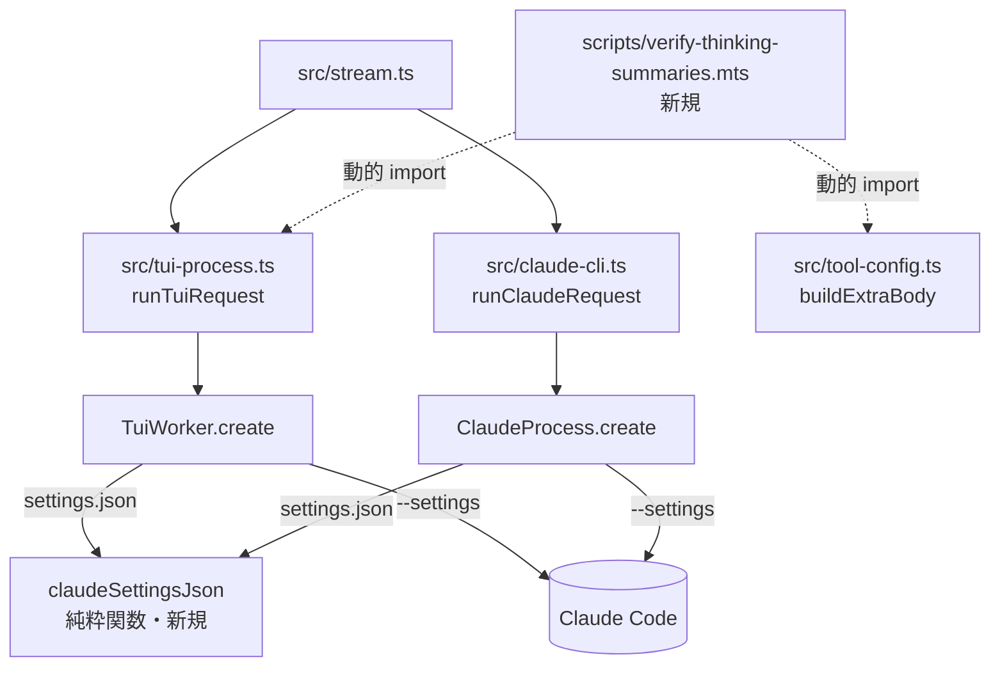

# 構成: settings.json に showThinkingSummaries: true を足す

## 結論

新しい本体のファイルは無い。settings.json の文字列を作る処理を `src/claude-cli.ts` の純粋関数 `claudeSettingsJson` の1か所に集め、TUI 経路と -p 経路はそれを呼ぶだけにする。今は2つの経路が同じ `JSON.stringify({ env: { CLAUDE_CODE_EXTRA_BODY: ... } })` を別々に書いており、片方だけに `showThinkingSummaries` を足す漏れと重複（jscpd）を防ぐためである。検証スクリプトは `scripts/verify-thinking-summaries.mts` に新しく置く（`examples/verify-thinking-summaries.mts` をそのまま複写する。設計時に `compare` を偽の記録で動かし、`tsc --strict` の型検査も通した。`run` は実機を使うため未実行）。

お手本:

| お手本 | 使い方 |
| --- | --- |
| `examples/tests-changes.diff` | `tests/claude-cli.test.ts`・`tests/tui-process.test.ts`・`tests/fixtures/fake-claude.mjs` の確定差分。本リポジトリで `git apply --check` が通る |
| `examples/verify-thinking-summaries.mts` | `scripts/verify-thinking-summaries.mts` にそのまま複写する |

設計時に一時の作業木（HEAD `aeebf0d`）で、`tests-changes.diff` と本書の `src/` の変更を当てて `npm test` 214件合格・`npm run check` 合格を確かめた。`src/claude-cli.ts` は 1146行、`src/tui-process.ts` は 280行になった。

## 層と依存の向き



- `src/tui-process.ts` は今も `./claude-cli.ts` から `processEnvironment`・`readyClaudeCommand` を import している。`claudeSettingsJson` を同じ import 文に足すため、依存の向きは増えない。
- `claudeSettingsJson` は何も import しない。ファイル・環境変数・時刻を読まない。
- 検証スクリプトは本体から import されない。引数のリポジトリの `src/` を動的 import するため、変更前の作業木にも使える。

## 型と関数

### `src/claude-cli.ts`

`export function processEnvironment(` の直前（`conflictingEnvironment` の閉じ括弧の後の空行の次）に置く。このファイルのコメントは英語のため、コメントは英語で書く。

```ts
// Claude Code 2.1.317 sends the redact-thinking-2026-02-12 beta unless showThinkingSummaries is true, and that beta
// strips the thinking text even when CLAUDE_CODE_EXTRA_BODY asks for display: "summarized".
export function claudeSettingsJson(extraBody: Record<string, unknown>): string {
  return JSON.stringify({ env: { CLAUDE_CODE_EXTRA_BODY: JSON.stringify(extraBody) }, showThinkingSummaries: true });
}
```

- 戻り値は settings.json にそのまま書く文字列である。オブジェクトを返して呼び出し側で `JSON.stringify` させる形にはしない（2か所の呼び出しに同じ変換を残さないため）。
- キーの順は `env`、`showThinkingSummaries` に固定する。
- `extraBody` を変更しない（`JSON.stringify` は読むだけである）。
- 定数を切り出さない（`SHOW_THINKING_SUMMARIES = true` のような定数は足さない）。値は1か所にしか現れないためである。

`ClaudeProcess.create` の中の次の1行を置き換える。

```ts
// 変更前
        writeFile(settingsPath, JSON.stringify({ env: { CLAUDE_CODE_EXTRA_BODY: JSON.stringify(input.extraBody) } }), "utf8"),
// 変更後
        writeFile(settingsPath, claudeSettingsJson(input.extraBody), "utf8"),
```

### `src/tui-process.ts`

import を次のように変える（`claudeSettingsJson` を先頭に足す）。

```ts
// 変更前
import { processEnvironment, readyClaudeCommand, type RunClaudeInput, type RunClaudeOutput } from "./claude-cli.ts";
// 変更後
import { claudeSettingsJson, processEnvironment, readyClaudeCommand, type RunClaudeInput, type RunClaudeOutput } from "./claude-cli.ts";
```

`TuiWorker.create` の中の次の1行を置き換える。直前の「output_config と context_management も起動したターンの値で残す。…」の2行のコメントは変えない。

```ts
// 変更前
        writeFile(paths.settings, JSON.stringify({ env: { CLAUDE_CODE_EXTRA_BODY: JSON.stringify(input.extraBody) } }), "utf8"),
// 変更後
        writeFile(paths.settings, claudeSettingsJson(input.extraBody), "utf8"),
```

`fingerprint`、`launchIdentity`、`tuiArgs` は変えない。

### `tests/fixtures/fake-claude.mjs`

起動時に読んだ settings.json 全体を記録できるようにする。先頭のコメントの `FAKE_SETTINGS_LOG` の行の後に1行足し、settings の読み方を次のように変える。

```js
// 先頭コメントに足す行（FAKE_SETTINGS_LOG の行の直後）
// FAKE_SETTINGS_DOC_LOG（起動時に読んだ --settings のファイル全体を JSON で1行ずつ書き出すファイル）、

// 変更前
const extraBodyText = settingsIndex > 0 ? JSON.parse(readFileSync(process.argv[settingsIndex + 1], "utf8")).env?.CLAUDE_CODE_EXTRA_BODY : undefined;
// 変更後
const settings = settingsIndex > 0 ? JSON.parse(readFileSync(process.argv[settingsIndex + 1], "utf8")) : undefined;
const extraBodyText = settings?.env?.CLAUDE_CODE_EXTRA_BODY;
```

`if (process.env.FAKE_SETTINGS_LOG) ...` の行の直後に次を足す。

```js
if (process.env.FAKE_SETTINGS_DOC_LOG) appendFileSync(process.env.FAKE_SETTINGS_DOC_LOG, JSON.stringify(settings ?? null) + "\n");
```

### `scripts/verify-thinking-summaries.mts`

`examples/verify-thinking-summaries.mts` と同じ内容にする。関数と責務は次のとおりである。

| 関数 | 責務 |
| --- | --- |
| `startProxy(records)` | relay と api.anthropic.com の間の中継。要求ごとに anthropic-beta（重複を除いて並べ替えた配列）と本文の5つのキーを `records` に積む。`scripts/verify-turn-body.mts` の同名関数と同じ |
| `shapeOf(content)` | 応答のブロックの形（`blockTypes`、thinking の `length`・`signatureLength`、`redacted` の件数、text の先頭40文字）を作る。思考の本文そのものは記録しない |
| `run(root, outPath, count)` | `count`（1〜4）回、別々のセッション ID で `runTuiRequest` を呼び、1回ごとに `closeTuiProcesses()` する。最初の失敗で止める。jsonl に書き出す |
| `hypothesisChecks(after)` | 判定 (1)・(2) |
| `pairChecks(before, after)` | 判定 (3)・(4)。同じ番号の記録どうしを比べる |
| `infoLines(before, after)` | 合否に数えない参考の行（変更前の thinking の形、anthropic-beta の増減） |
| `compare(beforePath, afterPath)` | 記録の完全さ（すべて `ok`、組が2件以上）と上の判定を出し、`summary` と `hypothesis: confirmed|rejected` を出す |

jsonl の1行の型:

```ts
interface ThinkingShape { length: number; signatureLength: number }
interface RunRecord {
  run: number; ok: boolean; error?: string; betas?: string[]; sent?: Record<string, unknown>;
  cacheRead?: number; blockTypes?: string[]; thinking?: ThinkingShape[]; redacted?: number; text?: string;
}
```

`scripts/verify-turn-body.mts` との重複（`startProxy` など）は、使い捨ての検証スクリプトどうしであり本体の重複ではないため、共通化しない。jscpd が scripts/ を対象に重複を出した場合は、その旨を `implementation-notes.md` に書く（本体 `src/` の重複はゼロであること）。

## 状態の持ち方

| 値 | 置き場所 | 種類 |
| --- | --- | --- |
| `showThinkingSummaries: true` | `claudeSettingsJson` の中の定数 | 保存しない。起動のたびに settings.json に書く |
| settings.json | worker ごとの一時ディレクトリ（今のまま） | worker の寿命の間だけ残る。閉じるときに消える（今のまま） |
| 指紋 | 今のまま | `showThinkingSummaries` を材料に入れない。定数のため、入れても入れなくても同じ値になる |

新しいモジュール変数・フィールドは無い。

## 例外の扱い

新しい例外は無い。`claudeSettingsJson` が投げうるのは `JSON.stringify` の `TypeError`（循環参照、`BigInt`）だけであり、今の行と同じく `create` の `try` の中で起き、今と同じ後始末（一時ディレクトリの削除など）を経て呼び出し元へ伝わる。業務エラーへの変換は足さない。

## 同時実行

変わらない。`claudeSettingsJson` は共有の状態を持たない純粋関数である。settings.json は worker ごとの一時ディレクトリに書くため、並行して起動する worker どうしで衝突しない（今のまま）。

## 古い応答の扱い

変わらない。relay・capture・`assertCompleteCapture` には触れない。

## 行数

| ファイル | 変更前 | 変更後の目安 |
| --- | --- | --- |
| `src/claude-cli.ts` | 1140行 | 1146行（関数5行と空行1行）。500行の目安を既に超えているが、今回は関心事を足さない（Claude Code の起動設定は既にこのファイルの責務）ため分割しない |
| `src/tui-process.ts` | 280行 | 280行（置き換えのみ） |
| `scripts/verify-thinking-summaries.mts` | なし | 160行。最長の関数は `run`（約40行）で50行以内 |
