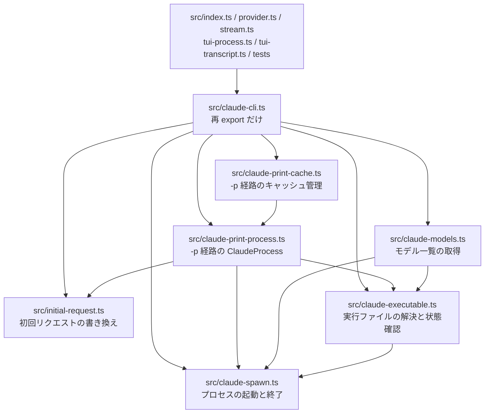

# 構成: src/claude-cli.ts を関心事ごとのファイルへ移す

## 結論

`src/claude-cli.ts` の最上位の文 52個を、下の「移す先の表」の6ファイルへ移す。新しいファイルどうしの依存は `claude-spawn` を一番下にした一方向の木にし、新しいファイルは入口の `src/claude-cli.ts` を import しない。入口は再 export の文だけを持つ。表・import 文・再 export の文は `examples/move-statements.mjs` と `examples/verify-move.mts` に同じ内容で書いてあり、本書を変えたら両方も変える。

## 層と依存の向き



新しいファイルが import してよい新しいファイルは次の表だけである。表に無い向き（例: `claude-spawn.ts` が `claude-executable.ts` を import する、`initial-request.ts` が `claude-print-process.ts` を import する）は循環のもとになるため禁止する。どの新しいファイルも `./claude-cli.ts` を import しない。

| ファイル | import してよい新しいファイル |
| --- | --- |
| `src/claude-spawn.ts` | なし |
| `src/claude-executable.ts` | `claude-spawn.ts` |
| `src/claude-models.ts` | `claude-spawn.ts`・`claude-executable.ts` |
| `src/initial-request.ts` | なし |
| `src/claude-print-process.ts` | `claude-spawn.ts`・`claude-executable.ts`・`initial-request.ts` |
| `src/claude-print-cache.ts` | `claude-print-process.ts` |

既存のファイル（`turn-relay.ts`・`transcript.ts`・`billing.ts` など）はどれも `claude-cli.ts` を import していない（設計時に grep で確認）ため、新しいファイルからそれらを import しても循環は生じない。

## 移す先の表

文の並びは表の順に書く。この順は、元のファイルでの出現順を保ったまま移す先ごとに抜き出した順である。行は HEAD `933f4fe` の `src/claude-cli.ts` の行番号（先頭コメントを除く）。

### `src/claude-spawn.ts`（プロセスの起動と終了、93行）

| 名前 | 種類 | 元の行 | export |
| --- | --- | --- | --- |
| `withConfigDirectory` | 関数 | 120–125 | 足す |
| `spawnCommand` | 関数 | 323–334 | 足す |
| `childExit` | 関数 | 336–344 | 足す |
| `killProcessTree` | 関数 | 346–365 | 元から |
| `conflictingEnvironment` | 関数 | 417–425 | 付けない |
| `claudeSettingsJson` | 関数（先頭に `//` コメント2行） | 429–431 | 元から |
| `processEnvironment` | 関数 | 433–455 | 元から |

### `src/claude-executable.ts`（実行ファイルの解決と状態確認、143行）

| 名前 | 種類 | 元の行 | export |
| --- | --- | --- | --- |
| `INSTALL_HINT` | 定数 | 26–28 | 元から |
| `LOGIN_HINT` | 定数 | 29 | 元から |
| `ClaudeStatus` | 型 | 31–40 | 元から |
| `configuredCommand` | 関数 | 84–86 | 足す |
| `executable` | 関数 | 88–95 | 付けない |
| `resolveClaudeExecutable` | 関数 | 97–118 | 元から |
| `captureProcess` | 関数 | 127–154 | 付けない |
| `getClaudeStatus` | 関数 | 156–183 | 元から |
| `READY_STATUS_TTL_MS` | 定数 | 185 | 付けない |
| `readyStatusCache` | モジュールの状態（`Map`） | 186 | 付けない |
| `readyClaudeCommand` | 関数（先頭に JSDoc） | 195–212 | 元から |

### `src/claude-models.ts`（モデル一覧の取得、113行）

| 名前 | 種類 | 元の行 | export |
| --- | --- | --- | --- |
| `isDiscoveredModel` | 関数 | 214–223 | 付けない |
| `discoverClaudeModels` | 関数（先頭に JSDoc） | 226–321 | 元から |

### `src/initial-request.ts`（初回リクエストの書き換え、166行）

| 名前 | 種類 | 元の行 | export |
| --- | --- | --- | --- |
| `requestMessages` | 関数 | 476–484 | 付けない |
| `deriveInitialUserPrefix` | 関数 | 486–495 | 足す |
| `deriveInitialSystemMessages` | 関数 | 497–511 | 足す |
| `contentText` | 関数 | 513–523 | 付けない |
| `removeRepeatedUserReminders` | 関数 | 525–552 | 付けない |
| `injectNativeSystemMessages` | 関数 | 554–583 | 元から |
| `normalizeLeadingSystemCache` | 関数 | 585–594 | 付けない |
| `rewriteInitialRequest` | 関数 | 596–638 | 元から |

### `src/claude-print-process.ts`（-p 経路の ClaudeProcess、506行）

| 名前 | 種類 | 元の行 | export |
| --- | --- | --- | --- |
| `RunClaudeInput` | 型 | 42–66 | 元から |
| `RunClaudeOutput` | 型 | 68–82 | 元から |
| `AsyncQueue` | クラス | 367–415 | 付けない |
| `writeFrame` | 関数 | 457–465 | 付けない |
| `nativeErrorText` | 関数 | 467–474 | 付けない |
| `CLAUDE_PROCESS_MAX_AGE_MS` | 定数 | 640 | 付けない |
| `ClaudeLaunchPlan` | 型 | 643–647 | 足す |
| `canonicalJson` | 関数 | 649–658 | 付けない |
| `digest` | 関数 | 660–662 | 付けない |
| `frameHistoryHash` | 関数 | 664–671 | 付けない |
| `launchPlan` | 関数 | 673–691 | 足す |
| `ClaudeProcess` | クラス | 693–1012 | 足す |

### `src/claude-print-cache.ts`（-p 経路のキャッシュ管理、144行）

| 名前 | 種類 | 元の行 | export |
| --- | --- | --- | --- |
| `MAX_CACHED_CLAUDE_PROCESSES` | 定数 | 641 | 付けない |
| `AcquiredProcess` | 型 | 1014–1019 | 付けない |
| `processCache` | モジュールの状態（`Map`） | 1021 | 付けない |
| `managerTail` | モジュールの状態（`Promise`） | 1022 | 付けない |
| `withManagerLock` | 関数 | 1024–1034 | 付けない |
| `expireProcess` | 関数 | 1036–1043 | 付けない |
| `discardProcess` | 関数（先頭に JSDoc） | 1046–1054 | 付けない |
| `acquireProcess` | 関数 | 1056–1095 | 付けない |
| `closeClaudeProcesses` | 関数（先頭に JSDoc） | 1098–1110 | 元から |
| `cachedClaudeProcessCount` | 関数（先頭に JSDoc） | 1113–1115 | 元から |
| `registerSessionResourceCleanup(...)` | 読み込み時に1回だけ実行する文 | 1117–1119 | 該当なし |
| `runClaudeRequest` | 関数 | 1121–1146 | 元から |

`MAX_CACHED_CLAUDE_PROCESSES` は元では `CLAUDE_PROCESS_MAX_AGE_MS` の次の行にあるが、使うのが `acquireProcess` だけのためキャッシュ管理の側へ移す。

## 写し方の決まり

- 文は先頭のコメント（JSDoc と `//` の行）ごと、1文字も変えずに写す。インデント・空白・末尾のカンマも変えない。
- 変えてよいのは「export を足す」9個の宣言の先頭に `export ` を足すことだけである。`export` を外す文は無い。
- 文と文の間は、元のファイルで隣り合っていた2文（`READY_STATUS_TTL_MS` と `readyStatusCache`、`processCache` と `managerTail` など）なら元の区切りをそのまま使い、それ以外は空行1行にする。
- 各ファイルは「import 文 → 空行1行 → 表の順の文 → 末尾の改行1つ」の形にする。ファイルの先頭にファイル全体の説明コメントは足さない（元のファイルにも無い）。
- この決まりは `examples/move-statements.mjs` がそのとおりに実行する。手で写さない。

## export を足す名前

別のファイルから使われるようになるため、次の9個に `export` を足す。入口の `src/claude-cli.ts` からは再 export しない（元は非公開だったため、入口から見える名前を増やさない）。

| 名前 | 定義するファイル | 使うファイル |
| --- | --- | --- |
| `withConfigDirectory` | `claude-spawn.ts` | `claude-executable.ts` |
| `spawnCommand` | `claude-spawn.ts` | `claude-executable.ts`・`claude-models.ts`・`claude-print-process.ts` |
| `childExit` | `claude-spawn.ts` | `claude-executable.ts`・`claude-models.ts`・`claude-print-process.ts` |
| `configuredCommand` | `claude-executable.ts` | `claude-print-process.ts` |
| `deriveInitialUserPrefix` | `initial-request.ts` | `claude-print-process.ts` |
| `deriveInitialSystemMessages` | `initial-request.ts` | `claude-print-process.ts` |
| `ClaudeLaunchPlan` | `claude-print-process.ts` | `claude-print-cache.ts` |
| `launchPlan` | `claude-print-process.ts` | `claude-print-cache.ts` |
| `ClaudeProcess` | `claude-print-process.ts` | `claude-print-cache.ts` |

## 各ファイルの import 文

TypeScript の型検査器で、各文が実際に参照する import と最上位の名前を解決して決めた。`tsconfig.json` が `verbatimModuleSyntax: true` のため、型だけの名前には必ず `type` を付ける。既存の `src/` と同じく相対パスは `.ts` の拡張子付きで書く。

`src/claude-spawn.ts`:

```ts
import { spawn, type ChildProcess } from "node:child_process";
import { envFlagEnabled } from "./env.ts";
```

`src/claude-executable.ts`:

```ts
import { constants as fsConstants } from "node:fs";
import { access } from "node:fs/promises";
import { delimiter, extname, isAbsolute, join, resolve } from "node:path";
import { childExit, killProcessTree, spawnCommand, withConfigDirectory } from "./claude-spawn.ts";
```

`src/claude-models.ts`:

```ts
import { createInterface } from "node:readline";
import type { DiscoveredClaudeModel } from "./model-catalog.ts";
import { childExit, killProcessTree, processEnvironment, spawnCommand } from "./claude-spawn.ts";
import { INSTALL_HINT, resolveClaudeExecutable } from "./claude-executable.ts";
```

`src/initial-request.ts`:

```ts
import type { NativeSystemInjection } from "./transcript.ts";
import { type NativeRequestMessage, setReplayCacheBreakpoints, withoutCacheControl } from "./cache-breakpoints.ts";
```

`src/claude-print-process.ts`:

```ts
import { createHash } from "node:crypto";
import { mkdtemp, rm, writeFile } from "node:fs/promises";
import { tmpdir } from "node:os";
import { join, resolve } from "node:path";
import { fileURLToPath } from "node:url";
import { createInterface } from "node:readline";
import type { ChildProcess } from "node:child_process";
import { incompleteUpstreamMessage } from "./relay-failure.ts";
import { TurnRelay } from "./turn-relay.ts";
import { usageCreditsAllowed, usageCreditsChargeError, type RateLimitInfo } from "./billing.ts";
import type {
  AnthropicStreamEvent,
  NativeFrame,
  NativeMessage,
  NativeOutputEvent,
  NativeResult,
  NativeUsage,
} from "./native-types.ts";
import { TOOL_PREFIX, type NativeSystemInjection, type ToolManifestEntry } from "./transcript.ts";
import { childExit, claudeSettingsJson, killProcessTree, processEnvironment, spawnCommand } from "./claude-spawn.ts";
import { configuredCommand, readyClaudeCommand } from "./claude-executable.ts";
import { deriveInitialSystemMessages, deriveInitialUserPrefix, rewriteInitialRequest } from "./initial-request.ts";
```

`src/claude-print-cache.ts`:

```ts
import { registerSessionResourceCleanup } from "@earendil-works/pi-ai";
import {
  ClaudeProcess,
  launchPlan,
  type ClaudeLaunchPlan,
  type RunClaudeInput,
  type RunClaudeOutput,
} from "./claude-print-process.ts";
```

元の5行目にあった `dirname` はどの文も使っていないため、どのファイルにも書かない。

## 入口の再 export（`src/claude-cli.ts` の全文）

```ts
export { claudeSettingsJson, killProcessTree, processEnvironment } from "./claude-spawn.ts";
export {
  getClaudeStatus,
  INSTALL_HINT,
  LOGIN_HINT,
  readyClaudeCommand,
  resolveClaudeExecutable,
  type ClaudeStatus,
} from "./claude-executable.ts";
export { discoverClaudeModels } from "./claude-models.ts";
export { injectNativeSystemMessages, rewriteInitialRequest } from "./initial-request.ts";
export type { RunClaudeInput, RunClaudeOutput } from "./claude-print-process.ts";
export { cachedClaudeProcessCount, closeClaudeProcesses, runClaudeRequest } from "./claude-print-cache.ts";
```

- 再 export 以外の文（import 文・宣言・コメント）を書かない。
- 型だけの名前は `type` を付ける。`--experimental-transform-types` で動かすとき、`type` の無い型の再 export は実行時に「その名前の export が無い」エラーになるためである。

## 型

型の形は変えない。移す型は `ClaudeStatus`・`RunClaudeInput`・`RunClaudeOutput`・`ClaudeLaunchPlan`・`AcquiredProcess` の5個で、どれも元の宣言をそのまま写す。

## 例外の扱い

例外を投げる箇所と文言は文ごと移すため変わらない。業務エラーの変換（`nativeErrorText`・`usageCreditsChargeError` の呼び出し）は `claude-print-process.ts` の `ClaudeProcess` の中の1か所のままである。新しい try/catch を足さない。

## 同時実行と状態の持ち方

- 保存する値（モジュールの状態）は3つで、どれも移した先のファイルに1つだけ置く。
  - `readyStatusCache`（`claude-executable.ts`）: 状態確認の結果を `READY_STATUS_TTL_MS` の間だけ持つ。
  - `processCache`（`claude-print-cache.ts`）: Pi のセッションごとの温めた `ClaudeProcess`。
  - `managerTail`（`claude-print-cache.ts`）: `withManagerLock` が直列化に使う Promise の鎖。
- `processCache`・`managerTail`・`withManagerLock` と、それを使う `expireProcess`・`discardProcess`・`acquireProcess`・`closeClaudeProcesses`・`runClaudeRequest` を同じファイルに置く。ロックと状態を別ファイルに分けると、ロックを通らずに状態を触る経路を作れてしまうためである。
- `processCache`・`managerTail`・`readyStatusCache` は export しない。
- ESM のモジュールは1回だけ評価されるため、入口経由でも新しいファイルからの直接の import でも、同じ状態を共有する。`registerSessionResourceCleanup(...)` も1回だけ実行される。
- 導出する値（`frameHistoryHash`・`launchPlan` の `key` など）は文ごと移すため、計算の仕方は変わらない。
- 古い応答の扱い（`CLAUDE_PROCESS_MAX_AGE_MS` を過ぎたプロセスを捨てる `expireProcess`、履歴の不一致で捨てる `acquireProcess`）も文ごと移すため変わらない。
- トランザクションは無い。

## 関数とファイルの大きさ

- 1関数50行の上限: この依頼では関数の中身を変えないため、50行を超える既存の関数（`discoverClaudeModels` 96行など）もそのまま移す。分割は次の依頼で行う。
- 1ファイル本体500行の目安: `claude-print-process.ts` は import 込みで506行になる。そのうち320行は1つのクラス `ClaudeProcess` であり、行数を合わせるためだけに `AsyncQueue` などを別ファイルへ出す分割はしない。ほかの5ファイルは93〜166行である。

## お手本

| お手本 | 使い方 |
| --- | --- |
| `examples/move-statements.mjs` | リポジトリの直下で1回実行する。本書の表・import 文・入口の全文どおりにファイルを書き出す。リポジトリには入れない |
| `examples/verify-move.mts` | 移した後に実行する。基準のコミットの `src/claude-cli.ts` と比べ、文の中身・並び・依存の向き・入口の再 export を確かめる。リポジトリには入れない |

設計時に一時の作業木（HEAD `933f4fe`）で両方を実行し、`npm run check` 合格・`npm test` 214件合格・`verify-move.mts` の `ok` を確かめた。
