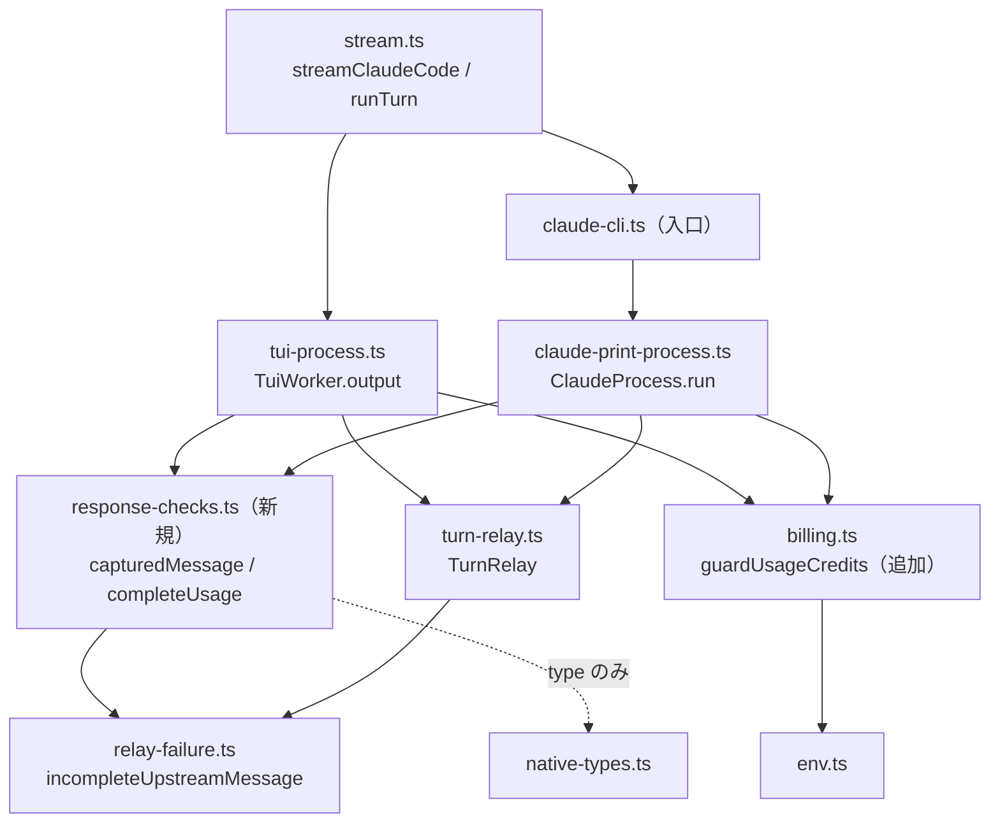

# 構成: R2 の分割と共通化

design.md の変更を、ファイル・関数・型の単位で決める。新しい共通部品の本体は examples/ にあり、実装担当はそれをコピーする。既存の関数の書き換えは、この文書の「呼び替え」と「分割」の節にある手順のとおりに行う。

## 層と依存の向き

変更後の依存は次のとおりである。矢印は import の向きを表す。新しい循環は作らない。



| モジュール | 責務 | 変更 |
| --- | --- | --- |
| `src/response-checks.ts` | 上流の応答が使える形かを判定する純粋関数。I/O を持たない | 新規（22 行） |
| `src/billing.ts` | 使用量クレジットの検出と止め方 | `guardUsageCredits` を追加 |
| `src/relay-failure.ts` | relay の失敗を最終文言にする | 変更なし |
| `src/turn-relay.ts` | 1ターン1要求の HTTP 中継 | `handle` を分割 |
| `src/stream.ts` | Pi の会話を要求にし、応答を Pi のイベントへ変換する | `streamClaudeCode` を分割 |
| `src/tui-process.ts` | 対話 TUI の worker 管理 | チェックを共通の関数へ呼び替え |
| `src/claude-print-process.ts` | -p 経路のプロセス管理 | チェックを共通の関数へ呼び替え |

`response-checks.ts` は `turn-relay.ts` を import しない。`TurnRelay` を型として受けると、テストで HTTP サーバーを立てる必要が出るためである。代わりに `relay-failure.ts` の `RelayOutcome` を広げた `CapturedOutcome` という形で受け、`TurnRelay` はその形を構造的に満たす。

## 型

```ts
// src/response-checks.ts（新規。examples/response-checks.ts のとおり）
export interface CapturedOutcome extends RelayOutcome {
  capture: { complete: boolean; message?: NativeMessage };
}

// src/stream.ts（export しない）
type DoneReason = Extract<AssistantMessageEvent, { type: "done" }>["reason"];
type FailedReason = Extract<AssistantMessageEvent, { type: "error" }>["reason"];
type PreparedRunInput = Omit<RunClaudeInput, "onEvent">;
```

- `AssistantMessageEvent` は `@earendil-works/pi-ai` から `type` として import する（`stream.ts` の既存の import 文の `type AssistantMessage,` の次の行に `type AssistantMessageEvent,` を足す）。
- `RunClaudeInput` と `RunClaudeOutput` は `./claude-cli.ts` から `type` として import する（既存の `import { runClaudeRequest } from "./claude-cli.ts";` を `import { runClaudeRequest, type RunClaudeInput, type RunClaudeOutput } from "./claude-cli.ts";` に変える）。
- `DoneReason` と `FailedReason` を Pi のイベント型から導出するのは、`stream.push` の引数の型と必ず一致させるためである。`StopReason` を手で並べない。

## 共通部品（新規）

### `src/response-checks.ts`

`examples/response-checks.ts` を `src/response-checks.ts` へコピーし、1行目のコメント（「実装担当は…」）だけを消す。中身は変えない。

### `src/billing.ts` の `guardUsageCredits`

`examples/billing-guard.ts` の4行目から8行目（`// 環境変数は…` のコメントから関数の閉じ括弧まで）を、`src/billing.ts` の `usageCreditsChargeError` の閉じ括弧の次の空行の後、`/** Rewrite an Anthropic usage-credit rejection` の行の前に貼る。前後に空行を1行ずつ置く。import は足さない。

### `tests/response-checks.test.ts`

`examples/response-checks.test.ts` を `tests/response-checks.test.ts` へコピーし、1行目のコメントだけを消す。`package.json` の `test` は `tests/*.test.ts` を読むので、設定は変えない。

## 呼び替え（共通部品を使う側）

### `src/tui-process.ts`

1. import を2行変える。
   - `import { usageCreditsAllowed, usageCreditsChargeError } from "./billing.ts";` を `import { guardUsageCredits } from "./billing.ts";` にする。
   - `import { incompleteUpstreamMessage } from "./relay-failure.ts";` を `import { capturedMessage, completeUsage } from "./response-checks.ts";` にする（行の位置は同じ）。
2. `assertCompleteCapture` の2行目と3行目（`if (relay.status === 200 ...) return relay.capture.message;` と `throw new Error(incompleteUpstreamMessage(relay));`）を、`return capturedMessage(relay);` の1行にする。1行目の `if (!relay.used) throw ...` は残す。
3. `TuiWorker.output` の先頭の usage の4行（`const usage = message.usage;` から `}` まで）を `const usage = completeUsage(message.usage);` の1行にする。
4. 同じ関数の課金の行（`if (rateLimit?.isUsingOverage === true && ...) throw usageCreditsChargeError(rateLimit);`）を `guardUsageCredits(rateLimit, { ...process.env, ...input.env });` にする。その前の `const rateLimit = this.relay.rateLimit;` は残す（戻り値の `rateLimit` に使う）。

### `src/claude-print-process.ts`（`ClaudeProcess.run`）

1. import を2行変える。
   - `import { incompleteUpstreamMessage } from "./relay-failure.ts";` を `import { capturedMessage, completeUsage } from "./response-checks.ts";` にする。
   - `import { usageCreditsAllowed, usageCreditsChargeError, type RateLimitInfo } from "./billing.ts";` を `import { guardUsageCredits, type RateLimitInfo } from "./billing.ts";` にする。
2. `if (this.relay.used) {` の中の4行（`if (this.relay.status !== 200 || ...) {`・`throw ...`・`}`・`message = this.relay.capture.message;`）を `message = capturedMessage(this.relay);` の1行にする。その次の `sawMessageStop = true;` は残す。
3. usage の4行（`const usage = message.usage ?? result.usage;` から `}` まで）を `const usage = completeUsage(message.usage ?? result.usage);` の1行にする。
4. 課金の3行（`if (rateLimit?.isUsingOverage === true && ...) {`・`throw usageCreditsChargeError(rateLimit);`・`}`）を `guardUsageCredits(rateLimit, { ...process.env, ...input.env });` の1行にする。直前の2行のコメント（`// The response is already charged ...`）は残す。
5. 上の4つ以外は変えない。`run` の分割はこの依頼で行わない。

## 分割（TUI 経路）

### `src/turn-relay.ts` の `TurnRelay.handle`

モジュール関数（クラスの外、`STRIPPED_RESPONSE_HEADERS` の定義の直後に、この順で置く。どれも `export` しない）:

| 名前 | 形 | 中身（変更前のどの行か） |
| --- | --- | --- |
| `MAX_ERROR_BODY_BYTES` | `const = 65_536` | エラー本文の上限。変更前は `65_536` を2回直書きしていた |
| `CONSUMED_BODY` | `const: Buffer` | 使用済みの要求に返す 400 の本文。変更前と同じ `JSON.stringify({ type: "error", error: { type: "invalid_request_error", message: "PI_CLAUDE_CODE_TURN_RELAY_CONSUMED" } })` をモジュール読み込み時に1回だけ作る |
| `isTurnRequest` | `(request: http.IncomingMessage, pathname: string, prefix: string) => boolean` | `request.method === "POST" && pathname === \`${prefix}/v1/messages\` && !request.headers.origin` |
| `rejectConsumed` | `(response: http.ServerResponse) => void` | `writeHead(400, { "content-type": "application/json", "content-length": CONSUMED_BODY.length }).end(CONSUMED_BODY)` |
| `mergeBetaHeader` | `(existing: http.OutgoingHttpHeader \| undefined, betas: string[]) => string` | 既存の `anthropic-beta` を `,` で分けて trim し、空を除き、`betas` を後ろに足して重複を除き、`,` で結ぶ。配列なら先に `join(",")`、無ければ `""` |
| `upstreamRequestHeaders` | `(incoming: http.IncomingHttpHeaders, bodyLength: number, betas: string[]) => http.OutgoingHttpHeaders` | `STRIPPED_REQUEST_HEADERS` と値が undefined のヘッダーを除いて写す → `accept-encoding` を `identity` → `content-length` を `bodyLength` → `betas` が1つ以上なら `anthropic-beta` を `mergeBetaHeader(headers["anthropic-beta"], betas)`。キーを足す順番もこのとおり |
| `downstreamResponseHeaders` | `(upstream: http.IncomingHttpHeaders) => http.OutgoingHttpHeaders` | `STRIPPED_RESPONSE_HEADERS` と値が undefined のヘッダーを除いて写し、最後に `connection` を `close` |
| `upstreamRequestId` | `(headers: http.IncomingHttpHeaders) => string \| undefined` | `String(headers["request-id"] ?? headers["x-request-id"] ?? "") \|\| undefined` |
| `appendErrorBody` | `(errorBody: Buffer<ArrayBuffer>, chunk: Buffer) => Buffer<ArrayBuffer>` | `errorBody.length >= MAX_ERROR_BODY_BYTES` なら `errorBody` をそのまま返す。そうでなければ `Buffer.concat([errorBody, chunk]).subarray(0, MAX_ERROR_BODY_BYTES)` |
| `sendUpstream` | `(upstreamRequest: http.ClientRequest, body: Buffer) => Promise<http.IncomingMessage>` | `once("response", resolve)`・`once("error", reject)`・`end(body)` の Promise |

`appendErrorBody` の型を `Buffer<ArrayBuffer>` にするのは、`errorBody` フィールドの型が `Buffer.alloc(0)` から `Buffer<ArrayBuffer>` と推論されているためである。`Buffer` と書くと `Buffer<ArrayBufferLike>` になり、tsc がフィールドへの代入を拒否する（設計時に実測）。

private メソッド（`handle` の直後、`waitForDrain` の前に、この順で置く）:

| 名前 | 形 | 中身 |
| --- | --- | --- |
| `readTurnBody` | `(request: http.IncomingMessage) => Promise<Buffer>` | `readBody` で読む → `originalRequestBody` に複製を保存 → `transformRequest` があれば通す → `requestBody` に複製を保存 → 本文を返す |
| `openUpstream` | `(headers: http.OutgoingHttpHeaders, search: string) => http.ClientRequest` | `pathPrefix` と `transport` を決め、`transport.request({...})` を作り（引数のキーと値は変更前と同じ。`path` は `\`${pathPrefix}/v1/messages${search}\``）、`this.sockets.add` してから返す |
| `relayResponse` | `(upstreamResponse: http.IncomingMessage, response: http.ServerResponse) => Promise<void>` | `sockets.add(upstreamResponse)` → `status`・`requestId`（`upstreamRequestId`）・`rateLimit` を保存 → `response.writeHead(statusCode ?? 502, downstreamResponseHeaders(...))` → チャンクごとに `lastActivityAt` を進め、200 なら `capture.feed`、それ以外は `errorBody = appendErrorBody(errorBody, chunk)`、`write` が偽なら `waitForDrain` → 200 なら `capture.finish()` → `response.end()` |

`handle` の変更後の流れ（39 行。この順を変えない）:

1. `requestUrl` を作る。`isTurnRequest(request, requestUrl.pathname, this.prefix)` が偽なら 404 を返して終わる。
2. `lastActivityAt` を進める。
3. `cancelled` か `used` なら `denied` を 1 増やし、`rejectConsumed(response)` して終わる。`denied` を増やすのは `handle` に残す（状態を変えるのはクラスの中だけにするため）。
4. `used = true`、`request` と `response` を `sockets` に足す。
5. `stage = "request"` で try に入る。`readTurnBody` → `cancelled` なら return → `upstreamRequestHeaders(request.headers, body.length, this.requestBetas)` でヘッダーを作る。
6. `stage = "connect"` → `upstreamRequest = this.openUpstream(headers, requestUrl.search)` → `await sendUpstream(upstreamRequest, body)`。
7. `stage = "disconnect"` → `await this.relayResponse(upstreamResponse, response)`。
8. catch と finally は変更前と1文字も変えない。

段階の切り替わる位置は変更前と同じである。ヘッダーの作成は `stage = "connect"` より前に行う。変更前もヘッダーを作ってから `connect` に切り替えていたためである。`openUpstream` の戻り値を `upstreamRequest` に入れるのは `try` の中で行い、`finally` が破棄できるようにする。

### `src/stream.ts` の `streamClaudeCode`

`normalizeError` の後、ファイルの末尾に、次の順で置く。どれも `export` しない（`streamClaudeCode` と `normalizeError` の export はそのまま）。

| 名前 | 形 | 中身（変更前のどの行か） |
| --- | --- | --- |
| `DoneReason`・`FailedReason`・`PreparedRunInput` | 型 | 上の「型」の節 |
| `newOutput` | `(model: Model<any>) => AssistantMessage` | 変更前の `const output: AssistantMessage = {...}` のオブジェクト。キーの順も同じ |
| `prepareRunInput` | `(model: Model<any>, context: TranscriptContext, options?: SimpleStreamOptions) => PreparedRunInput` | 変更前の `repairedContext` から `extraBody` までの計算を、変更前と同じ順番・同じ一時変数名（`tools`・`frames`・`initialUserPrefix`・`initialSystemMessages`・`preparedTools`・`extraBody`）で行い、`runRequest({...})` に渡していたオブジェクトから `onEvent` を除いたものを返す。`cwd` は `process.cwd()`。計算を返すオブジェクトの中へ移して順番を変えない（どれかが投げたとき、変更前と同じ関数のエラーが出るようにするため）。33 行 |
| `turnDiagnostics` | `(response: RunClaudeOutput) => NonNullable<AssistantMessage["diagnostics"]>` | `claude-code.turn-relay` の1件と、`response.rateLimit` があるときの `claude-code.rate-limit` の1件の配列。`timestamp` は各要素で `Date.now()`、`details` は `as never`（変更前と同じ） |
| `finishedReason` | `(output: AssistantMessage) => DoneReason` | `stopReason` が `error`・`aborted`・`pending` なら `new Error(output.errorMessage \|\| \`Claude Code ended with ${reason}\`)` を投げ、それ以外はその値を返す |
| `markFailed` | `(output: AssistantMessage, error: unknown, signalAborted: boolean) => FailedReason` | `signalAborted \|\| isAbortError(error)` なら `"aborted"`、それ以外は `"error"` を `output.stopReason` に入れ、`errorMessage` に `normalizeError(error)` を入れ、各 block から `nativeIndex` と `partialJson` を消し、その reason を返す |
| `runTurn` | `(model, context, options: SimpleStreamOptions \| undefined, stream: AssistantMessageEventStream, output: AssistantMessage) => Promise<void>` | 下の流れ |
| `streamClaudeCode` | 変更前と同じ形 | `stream` を作る → `output = newOutput(model)` → `void runTurn(model, context, options, stream, output)` → `stream` を返す |

`runTurn` の流れ（26 行。この順を変えない）:

1. try の中で `prepareRunInput` → `new EventTranslator(model, output, stream)` → `stream.push({ type: "start", partial: output })`。要求の準備で投げたときは `start` を流さずに `error` を流す（変更前と同じ）。
2. 実行経路を選ぶ。`// claude -p は entrypoint=sdk-cli として…` のコメントは、この行の直前へそのまま移す。
3. `await runRequest({ ...input, onEvent: (event) => translator.event(event) })`。
4. `translator.finish(...)` → `output.providerThinkingLevel = options?.reasoning` → `output.diagnostics = [...(output.diagnostics ?? []), ...turnDiagnostics(response)]`。
5. `const reason = finishedReason(output)` → `stream.push({ type: "done", reason, message: output })` → `stream.end()`。
6. catch で `const reason = markFailed(output, error, options?.signal?.aborted === true)` → `stream.push({ type: "error", reason, error: output })` → `stream.end()`。

`streamClaudeCode` は `runTurn` を `await` せずに `void` で呼ぶ。`runTurn` は最初の `await` までを同期で実行するので、`start` を流すまでの処理が `streamClaudeCode` の戻る前に終わる点は、変更前の即時実行の無名関数と同じである。`runTurn` は catch で例外をすべて受けるため、拒否された Promise を残さない。

## 例外の扱い

業務エラーへの変換は、変更前と同じく `stream.ts` の `markFailed`（中で `normalizeError` を呼ぶ）の1か所だけで行う。共通にした3つの関数は `Error` を投げるだけで、文言の書き換え（`context_length_exceeded:` の接頭辞や billing の言い換え）をしない。relay の失敗の文言は、これまでどおり `relay-failure.ts` の `incompleteUpstreamMessage` が作る。

`turn-relay.ts` で分けたメソッドとモジュール関数は、例外を受けない。すべて `handle` の try まで伝わり、そこで `stage` と `CaptureError` から `RelayFailure.kind` を決める。分けた関数の中に try を足さない。

## トランザクションと同時実行

データベースやファイルへの書き込みは無い。同時実行に関わる状態は変えない。

- `TurnRelay` は1ターンに1要求だけを中継する。`used` の確認と設定は `handle` の中で `await` を挟まずに続けて行う（変更前と同じ）。分割で `isTurnRequest` と `rejectConsumed` を呼ぶようになっても、その間に `await` は入らない。2本目の要求が同時に届いても、片方だけが `used` を立て、もう片方は 400 で拒否される。
- `readTurnBody` の後の `if (this.cancelled) return;` は残す。本文を読んでいる間に `finishTurn` が呼ばれたときに、上流へ送らないためである。
- `TuiWorker` の `busy`・`reserve`・`release` と、worker の Map の扱いは変えない。

## 状態の持ち方

保存する値は変えない。`TurnRelay` のフィールド（`used`・`denied`・`status`・`requestId`・`rateLimit`・`failure`・`errorBody`・`originalRequestBody`・`requestBody`・`lastActivityAt`）を書き換えるのは、`handle` と3つの private メソッドだけである。モジュール関数は `this` を持たず、引数から値を返すだけにする。

導出する値（ヘッダー、request-id、エラー本文の連結、`RunClaudeInput`、診断情報、stopReason）は、すべて引数から計算する関数にした。`appendErrorBody` は新しい Buffer を返し、呼び出し側が `errorBody` に入れ直す。

## 古い応答の扱い

変えない。前のターンの応答を次のターンで使わないための仕組みは、`beginTurn` がフィールドを初期化し、`finishTurn` がソケットを閉じることである。分割した `relayResponse` はそのターンの `this.capture` にだけ書く。

## 部品の分割と行数

1関数は 50 行以内にする。変更後の行数（設計時の実測）は次のとおりである。

| 関数 | 行数 |
| --- | --- |
| `TurnRelay.handle` | 39 |
| `TurnRelay.readTurnBody` / `openUpstream` / `relayResponse` | 7 / 14 / 17 |
| `upstreamRequestHeaders` / `downstreamResponseHeaders` / `sendUpstream` | 14 / 8 / 7 |
| `isTurnRequest` / `rejectConsumed` / `mergeBetaHeader` / `upstreamRequestId` / `appendErrorBody` | 3 / 3 / 4 / 3 / 4 |
| `streamClaudeCode` | 10 |
| `runTurn` / `prepareRunInput` | 26 / 33 |
| `newOutput` / `turnDiagnostics` / `finishedReason` / `markFailed` | 12 / 8 / 7 / 10 |
| `capturedMessage` / `completeUsage` / `guardUsageCredits` | 4 / 6 / 3 |
| `TuiWorker.output` / `assertCompleteCapture` | 18 / 4 |

1ファイルは本体 500 行を目安にする。変更後は `turn-relay.ts` 428 行、`stream.ts` 447 行、`claude-print-process.ts` 490 行で、どれも目安の内に収まる。行数を減らすためだけのファイル分割はしない。`turn-relay.ts` のヘッダー関数を別ファイルへ出すことや、`stream.ts` の `EventTranslator` を別ファイルへ出すことは、この依頼では行わない（関心事は今のファイルと同じで、目安も超えないため）。

## コメント

新しく書くコメントは「なぜ」だけにする。`examples/` のコメントはそのまま使う。分割で移す既存のコメント（`// claude -p は entrypoint=sdk-cli として…`、`// The response is already charged at this point, ...`）は、文言を変えずに対応する行の直前へ移す。手順の説明（「ヘッダーを作る」など）のコメントは足さない。
