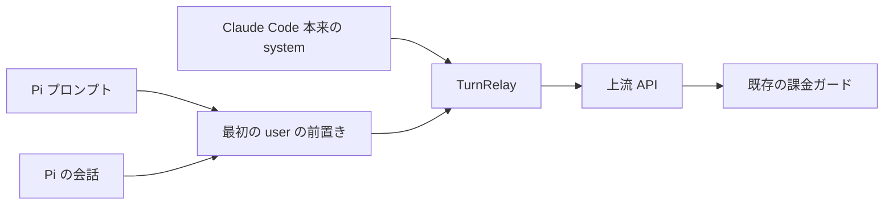

# スパイク結果: 対話 TUI の claude を relay 経由で動かす（2026-11-03）

使い捨てコードは `spike/`（git 管理外）。Claude Code 2.1.316、Haiku 5.5、WSL2、tmux で PTY を代用。

| # | 確かめたこと | 結果 |
|---|---|---|
| 1 | relay に届くリクエストの請求ラベル | ○ ヘッダーではなく本文の system 先頭 `x-anthropic-billing-header: cc_version=…; cc_entrypoint=cli;`。UA は `claude-cli/2.1.316 (external, cli)`、`x-app: cli` |
| 2 | relay で messages を丸ごと別の複数ターンの会話に差し替える | ○ 200 が返り、差し替えた会話の文脈で答え、TUI はそのまま入力待ちに戻る |
| 3 | tool_use の後の2本目以降を relay が拒否する | ○ inert MCP の呼び出しは許可画面なしで通る（`--allowedTools mcp__pi`）。拒否後、Claude Code は `CLAUDE_CODE_MAX_RETRIES=0` でも追加で1本送る → **ターン内の2本目以降はすべて拒否**が必要。TUI は「API Error: 400」を出して入力待ちに戻る |
| 4 | プロセスの使い回し | ○ `--disable-slash-commands` を外せば `/clear` が効き、次のリクエストは messages 2件・新しい session-id から始まる。付けたままだと `Unknown command: /clear` |

## 設計への反映
- 請求ラベルは Claude Code が system に書くため、relay は messages を差し替えても system 先頭ブロックには触らない
- 差し替える messages には、Claude Code が入れる role=system のメッセージ（環境情報、`<total_tokens>` など）が混ざる。pi-claude-code の `rewriteInitialRequest` が扱う「初期 system メッセージ」の考え方を全履歴の差し替えに広げる
- relay は「ターンごとに最初の1本だけ転送、残りは 400」。既存 TurnRelay の挙動と同じ
- tool_use 境界でもプロセスを捨てず、ターン終了ごとに `/clear` を送って使い回す（起動 5〜7 秒をツール往復ごとに払わない）
- `--disable-slash-commands` は使わない。Pi の発言が `/` で始まる誤爆は、先頭に改行を入れて貼る（magpie の `pasteable` と同じ）ことで防ぐ

## 結合試験の結果（2026-11-03 08:30）
pi -ne -e src/index.ts で Haiku 5.5 に1ターン依頼したところ、上流が HTTP 400 で拒否した。entrypoint は cli だった。

> Third-party apps now draw from your extra usage, not your plan limits.

スパイクで system に目印の文字列だけを入れたときは 200 が返っていた。Pi の実際の system プロンプトと会話を載せた試験では、上流がサードパーティアプリ向けの使用量クレジットを要求した。この時点では、プロンプト内容と配置のどちらが判定に影響したかは未検証だった。

## Pi プロンプトの配置比較

Pi プロンプトを `--system-prompt-file` で渡さず、`replaceTranscript(body, frames, systemPrompt, injections)` で最初の user の system-reminder と会話本文の間にテキストブロックとして置く形に変更した。Claude Code 本来の system、ツール定義、課金ガード、ターン内の追加リクエスト拒否は変更していない。空の Pi プロンプトではブロックを追加しない。

同じ作業ディレクトリ、Haiku、thinking off、確認文で変更前後を各1回試した。Pi は `-ne -e src/index.ts --no-mcp --no-skills --no-context-files --no-session` で起動し、通常の Pi 生成プロンプトは有効にした。TUI とフォルダ信頼の自動応答を明示的に有効化し、`PI_CLAUDE_CODE_ALLOW_USAGE_CREDITS=0` を指定した。変更前は HEAD `233eac5` の src を一時ディレクトリへ展開して実行した。

| 配置 | 結果 | Pi 終了コード |
|---|---|---|
| system（変更前） | HTTP 400、Third-party apps now draw from your extra usage | 1 |
| 最初の user（変更後） | 指定した `TUI_USER_PROMPT_OK` を受信 | 0 |

この最小条件では配置変更後に応答を取得できた。成功だけではプラン枠への計上や将来の判定を保証できず、ローカルの課金ガードも課金済み応答を事後検知するため、課金自体を未然に防ぐ保証にはならない。

## ツール往復と複数ターンの結合試験

Pi の RPC モードから、未知のランダムな文字列を書いた一時ファイルを read で読ませ、その内容を回答させた。次の user 発言ではツールを使わせず、直前の内容を再度回答させた。最初の試行ではツール結果を送る時点でキャッシュ区切りが5個となり HTTP 400 になったため、上流の system・tools が使う区切りを数えて messages の枠を制限する修正を行った。

修正後は、スキル・コンテキストファイルなしの条件と、それらを読み込む条件の両方で成功した。他の拡張と外部 MCP は無効であり、普段の拡張一式との共存試験ではない。

| 検証項目 | 結果 |
|---|---|
| Pi の read ツール実行と結果を使った回答 | 両条件で成功 |
| 次の user 発言に対する履歴を使った回答 | 両条件で成功 |
| プロセス再利用 | 各条件の3回のモデル呼び出しで同じ PTY helper PID |
| 上流転送 | モデル呼び出しごとに1回 |
| ツール呼び出し後の Claude Code の回復要求 | 追加2本をどちらも拒否 |
| 使用量ヘッダー | 全呼び出しで status=allowed、overage-status=rejected、isUsingOverage=false |
| 試験終了後の PTY helper | 対象リポジトリの残留プロセスなし |

結合試験には git 管理外の使い捨てスクリプトを使用した。スクリプトと実行ログは公開リポジトリには含めない。Pi の終了コードだけではモデルエラーを検出できない場合があったため、各 assistant の stopReason・ツール使用・返されたファイル内容・転送回数を検証した。

## 機械的検証

Node.js 24.22.2 を使用した。起動中断後の上流送信、キャッシュ区切り超過、途中の system／ツール差分欠落、Python の起動失敗、タイムアウト設定変更時の再利用、待機期限の未破棄に対して、それぞれ AssertionError の Red を確認してから修正した。

- 単体テスト81件（GitHub 公開用メタデータの検証3件を含む）。偽 Claude Code とローカル上流を使い、実サービスには送信しない。
- 型チェック成功、今回変更した TUI 本番7ファイルの fast-lint 成功。Python helper は ruff check・ruff format --check・mypy --strict も成功。
- src 全体の jscpd は重複0。
- TUI 関連7ファイルの TypeScript AST 集計では、循環的複雑度最大9、関数最大30行、ファイル最大250行。継承した claude-cli.ts・stream.ts・transcript.ts・turn-relay.ts の既存のサイズ超過はこの範囲に含めない。今回 claude-cli.ts は既存の注入関数の export のみ変更した。
- npm pack --dry-run で Python helper と inert MCP の同梱を確認した。

初回の独立レビューでは利用条件上の懸念で技術審査を引き受けてもらえなかった。別のレビュアーによる技術審査で実装上の反例5件が報告されたため、次の修正と回帰テストを追加した。

| 指摘 | 修正・検証 |
|---|---|
| ツール引数の cache_control が失われる | 注釈の除去・集計をプロトコル位置へ限定し、input／input_schema と元の配列を保持 |
| 起動中・使い捨ての worker が破棄対象外 | tui-lifecycle.ts で要求をキャッシュ登録前から追跡し、破棄時には中断と清掃完了を待つ |
| SIGHUP を無視する子・孫が残留 | Python がプロセスグループを清掃し、close・helper SIGTERM・Claude SIGTERM・PTY 継承の孫を伴う本体 SIGTERM の4条件で生存プロセスなしを検証 |
| 端末問い合わせの分割配送を取りこぼす | 未完了な接尾辞を保持し、全分割位置・一文字ずつ・同一問い合わせの連続を検証 |
| 分を含む終了表示を認識しない | 秒・分・時の表示と、終了表示後に再び busy になる反例を検証 |

各不具合は修正前に AssertionError の Red を確認した。再審査で PTY を継承した孫の追加反例が見つかったため、この条件も Red に固定し、waitid(WNOWAIT) の0.1秒周期の終了検知を追加した。識別子 fd／cols も file_descriptor／columns に変更した。独立レビュアーは修正後に78件のテストと型チェックを再実行して技術面を承認した。この承認は利用条件上の許可や課金保証ではない。

## 単発の実機タイムアウト

技術レビュー後のコンテキストありの実機試験で、試験スクリプトの100秒期限に1回到達した。この試行では詳細なイベントログを記録しておらず、原因は未特定である。プロバイダ側の期限を検証した結果や、実装上の不具合と確定した結果ではない。

試験スクリプトに assistant の終了とツール開始のイベントログを追加して再試行すると、最小条件・コンテキストありの両条件でそれぞれ約8秒で成功した。各条件とも read・内容回答・次の user 発言での履歴回答を同じ PTY で処理し、上流への転送は各1回、追加の回復要求2本は拒否した。試験終了後に約1秒待ち、対象の PTY helper が残留していないことも確認した。

## GitHub 公開用のパッケージ情報

パッケージ名は `pi-claude-code-tui`、repository は `MINTY1st/pi-claude-code-tui` とした。元の MIT ライセンスと著作権表示は変更しない。`private: true` で npm への誤公開を防ぎ、設計書から参照する docs をパッケージの対象へ追加した。これらの整合性を別途3件の回帰テストで確認する。
