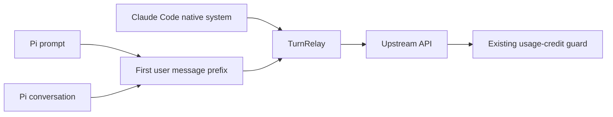

# Experiment report: interactive Claude Code through a relay

Date: 2026-11-03. Initial throwaway experiments used Claude Code 2.1.316, Haiku 5.5, WSL2, and tmux as a PTY substitute. Experiment scripts and logs are not included in the public repository.

## Initial observations

| Experiment | Observation |
|---|---|
| Request billing label | The label appeared at the beginning of the system body, not as a header: `x-anthropic-billing-header: cc_version=...; cc_entrypoint=cli;`. User agent: `claude-cli/2.1.316 (external, cli)`; `x-app: cli`. |
| Replace messages with another multi-turn conversation | HTTP 200; the model answered from the substituted conversation and the TUI returned to its prompt. |
| Reject requests after tool_use | Inert MCP calls passed without an approval dialog using `--allowedTools mcp__pi`. After rejection, Claude Code made another recovery request even with `CLAUDE_CODE_MAX_RETRIES=0`. All requests after the first must be rejected. The TUI displayed `API Error: 400` and returned to its prompt. |
| Reuse a process | `/clear` worked without `--disable-slash-commands`, resetting to two messages and a new session ID. With that flag, it returned `Unknown command: /clear`. |

## Design consequences

- Keep Claude Code's original leading system blocks when replacing messages.
- Generalize upstream `rewriteInitialRequest` handling of native system/environment messages to full-history replay. These can include environment context and changing `<total_tokens>` information.
- Forward the first upstream request for a model call and reject all later requests in that call with HTTP 400, as enforced by `TurnRelay`.
- Reuse a worker across tool round trips and clear between calls, avoiding repeated startup observed at roughly 5–7 seconds in these experiments.
- Do not set `--disable-slash-commands`, because reuse needs `/clear`. The initial paste experiment used a leading newline for slash-prefixed text, following magpie's `pasteable` approach. The production adapter submits the fixed `continue` trigger and restores the real conversation in the relay.

## Initial integration failure

At 08:30 on the experiment date, a one-turn Haiku request using `pi -ne -e src/index.ts` was rejected with HTTP 400 despite a `cli` entrypoint:

> Third-party apps now draw from your extra usage, not your plan limits.

A marker-only system prompt had received HTTP 200 in the earlier spike. At this stage it was not established whether prompt content or placement affected classification.

## Pi prompt placement comparison

Remove `--system-prompt-file` from the TUI path and pass Pi's prompt to `replaceTranscript(body, frames, systemPrompt, injections)`. Insert it between Claude Code's leading user system-reminder and Pi's first user content. Keep Claude Code's native system, tools, usage-credit guard, and additional-request rejection unchanged. An empty Pi prompt adds no block.

Compare one request per placement with the same working directory, Haiku, thinking disabled, and confirmation task. Pi ran with `-ne -e src/index.ts --no-mcp --no-skills --no-context-files --no-session`, retaining its normally generated prompt. TUI mode and automatic folder-trust approval were explicitly enabled; `PI_CLAUDE_CODE_ALLOW_USAGE_CREDITS=0` was set. The old path used source from commit `233eac5` in a temporary directory.

| Placement | Result | Pi exit code |
|---|---|---|
| System, before change | HTTP 400: third-party apps draw from extra usage | 1 |
| First user, after change | Received `TUI_USER_PROMPT_OK` | 0 |

The user placement obtained a response under this minimal condition. This does not establish service authorization, plan billing, or future classification behavior. The existing guard detects billing after a response and cannot prevent an initial charge.

## Tool round trip and multi-turn integration

Via Pi RPC, ask the model to read a temporary file containing an unknown random string and return its contents. Then ask it to recall the string without tools. The first attempt failed during the tool-result call because the request had five cache breakpoints. Count the original system/tool markers and restrict the message budget to keep the total within four.

After the fix, both the minimal condition and a condition loading skills/context files passed. Other extensions and external MCP servers were disabled; this was not a coexistence test with a full personal extension setup.

| Check | Result |
|---|---|
| Pi read tool and content-based answer | Passed under both conditions |
| Next user message answered from history | Passed under both conditions |
| Process reuse | Same PTY helper PID for each condition's three model calls |
| Upstream forwarding | One request per model call |
| Claude Code recovery after tool call | Both additional requests rejected |
| Usage headers | All calls: `status=allowed`, `overage-status=rejected`, `isUsingOverage=false` |
| PTY helper after test | No matching live helper remained |

Pi's process exit code alone did not reliably distinguish model errors. The acceptance script also checked each assistant's stop reason, tool execution, returned content, and relay counters. Scripts and raw logs remain outside the public package.

## Automated verification history

The original publication check used Node.js 24.22.2 and passed 81 tests, including three metadata tests, plus TypeScript checking. Tests use a fake Claude Code and local upstream, not the real model service. Reproductions failed with AssertionError before fixes for startup cancellation, cache overflow, missing intermediate system/tool changes, Python startup failure, timeout-sensitive worker reuse, and idle expiry.

- Seven changed TUI production files passed fast-lint. The Python helper passed `ruff check`, `ruff format --check`, and `mypy --strict`.
- `jscpd` found zero clones across `src`.
- AST metrics for seven TUI-related TypeScript files: maximum complexity 9, maximum function length 30 lines, maximum file length 250 lines. Inherited oversized files (`claude-cli.ts`, `stream.ts`, `transcript.ts`, and `turn-relay.ts`) were outside that metric scope.
- `npm pack --dry-run` included the Python helper and inert MCP server.

The first independent reviewer declined technical review over service-terms concerns. Another reviewer found the following counterexamples; all were reproduced with failing assertions before correction.

| Finding | Regression coverage |
|---|---|
| cache_control removed from tool arguments | Restrict annotation counting/removal to protocol locations; preserve input, schemas, and original arrays |
| Startup/disposable workers omitted from disposal | Track requests before cache registration; abort and await cleanup |
| SIGHUP-ignoring descendants survive | Group cleanup tested for close, helper SIGTERM, leader SIGTERM, and leader SIGTERM with a PTY-inheriting grandchild |
| Terminal queries split across chunks lost | Every split position, one-character delivery, and repeated queries |
| Minute-containing completion line missed | Seconds/minutes/hours and a later busy indicator |

A further review found the inherited-PTY grandchild case. A regression failed before adding 0.1-second `waitid(WNOWAIT)` polling. Abbreviated identifiers `fd` and `cols` were also renamed. The reviewer reran 78 tests and type checking at that stage and approved the technical changes; the three original metadata tests were added afterward. Technical approval is not service authorization or a billing guarantee.

## Isolated live-test timeout

After technical review, one context-enabled acceptance run hit the test script's 100-second deadline. Detailed events were not recorded for that attempt, so the cause remains unknown. This did not establish a provider-timeout defect.

After adding assistant-completion and tool-start event logging, both minimal and context-enabled retries passed in roughly eight seconds each. Each reused one PTY for read, answer, and history recall; upstream forwarding remained one request per call, and both recovery requests were rejected. About one second after shutdown, no matching helper remained.

## npm release preparation

The initial GitHub-only package was unscoped and used `private: true`. The unscoped npm name was later found to belong to an unrelated project. The prepared release name is `@minty1st/pi-claude-code-tui`, with public npm access and the `pi-package` gallery keyword. Authentication and scope ownership must be confirmed before publishing; release preparation is not evidence of a published package.

The upstream MIT license stays unchanged. [THIRD_PARTY_NOTICES.md](../THIRD_PARTY_NOTICES.md) includes magpie attribution and its complete MIT notice. Documentation and notices are included in the package. The metadata regression suite now also checks the scoped release configuration, gallery manifest, license inclusion, and English documentation; the 81-test result above describes the earlier checkpoint rather than this later suite.
