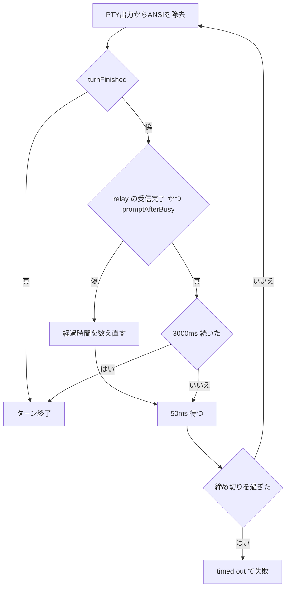

# ターン終了の判定

`src/pty-session.ts` の `waitIdle` は、終了行による判定（`turnFinished`）と、終了行を取りこぼしたときの補助判定でターンの終わりを決める。

## 終了行による判定

`src/tui-screen.ts` の `turnFinished` は、終了行の後ろに入力欄があり、それより後ろに新しい応答中の表示がないことを確認する。

終了行は次の表記を受け付ける。

- `✻ Worked for 12s`（分・時も含む）
- `✻ Crunched for 5m 12s · done 12:12 AM`
- `✻ Crunched for done 12:12 AM`（差分描画で所要時間が残らない場合）

Claude Code 2.1.317 の実行ファイルには終了時刻を追加する表示が存在する。最後の表記はタイムアウト時の画面で観測したもの。所要時間が消えた原因が差分描画かどうかは未確定。

## 補助判定

2026-11-06 に、入力欄は描かれているのに終了行が画面に残らず、300 秒待って失敗したターンがあった。終了行が無いときは、次の2つが 3000ms（`promptFallbackMs`）続いたらターンの終わりとみなす。

- relay が上流の応答を最後まで受け取った（`relay.capture.complete`）
- 最後に描かれた入力欄より後ろに `esc to interrupt` が無い（`promptAfterBusy`）

貼り付けた直後の画面と、応答中の表示の後ろに入力欄が描き直された画面も2つ目の条件を満たす。このため2つ目の条件だけでは終了とみなさず、上流の受信完了と組み合わせる。補助判定は締め切り（最後の上流活動 + `timeoutMs`）を延ばさない。

## 未対応の参考指摘

- 時刻の末尾に境界がないため、`done 12:123` も一致する。
- スピナー文言が終了行に似ていてbusy表示も差分描画で欠落すると、誤認の可能性がある。

## 確認結果

- 観測した画面で修正前は AssertionError、修正後は成功。
- `npm test` は171件合格、`npm run check` は合格。
- 独立 reviewer の承認は、この変更の PR で確認する。
