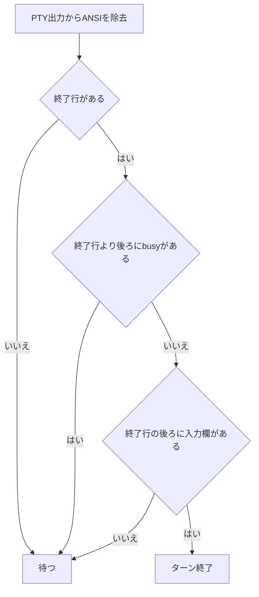

# ターン終了の判定

`src/tui-screen.ts` の `turnFinished` は、終了行の後ろに入力欄があり、それより後ろに新しい応答中の表示がないことを確認する。

終了行は次の表記を受け付ける。

- `✻ Worked for 12s`（分・時も含む）
- `✻ Crunched for 5m 12s · done 12:12 AM`
- `✻ Crunched for done 12:12 AM`（差分描画で所要時間が残らない場合）

Claude Code 2.1.317 の実行ファイルには終了時刻を追加する表示が存在する。最後の表記はタイムアウト時の画面で観測したもの。所要時間が消えた原因が差分描画かどうかは未確定。

## 未対応の参考指摘

- 時刻の末尾に境界がないため、`done 12:123` も一致する。
- スピナー文言が終了行に似ていてbusy表示も差分描画で欠落すると、誤認の可能性がある。

## 確認結果

- 観測した画面で修正前は AssertionError、修正後は成功。
- 全120テスト成功、TypeScript型検査成功、独立reviewer承認済み。
