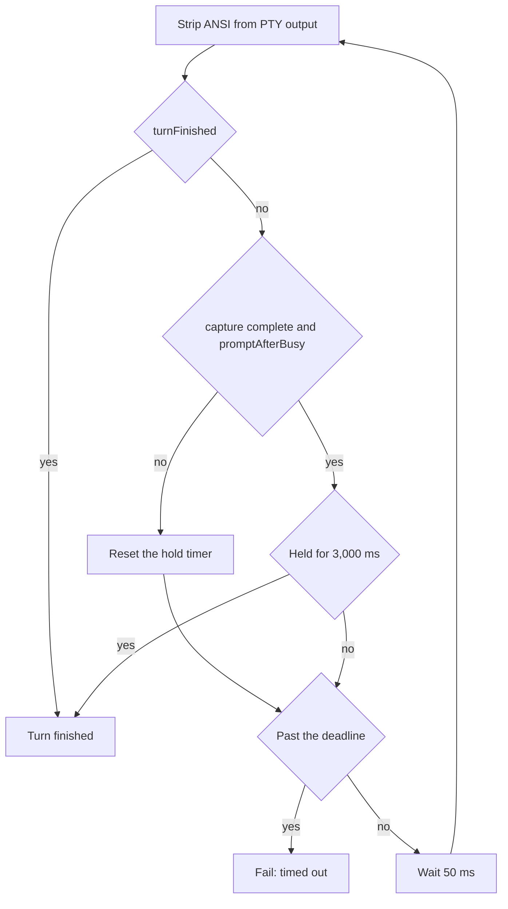

# Turn lifecycle (interactive TUI)

This describes how one Pi call runs through the interactive TUI path (`src/tui-process.ts`, `src/pty-session.ts`, `src/tui-screen.ts`).

## Steps

1. **Acquire a worker** — reuse the session's cached Claude Code process if it is compatible, otherwise start one (see [Worker reuse](worker-reuse.md)).
2. **Begin the turn** — the relay is told how to rewrite the next request: replace the transcript with Pi's frames and write the per-turn values.
3. **Submit** — `continue` is pasted into the TUI. Its only purpose is to make Claude Code send one request.
4. **Wait for the end of the turn** — `waitIdle` watches the screen (see below).
5. **Collect the result** — the response captured by the relay is checked and returned to Pi (see [Errors and retries](errors-and-retries.md)).
6. **Clear** — `/clear` is sent in the background so the TUI's own history is empty before the next turn. If it does not come back, the worker is marked broken and replaced next time.

## Detecting the end of a turn

The screen is read without a terminal emulator: ANSI escapes are removed from the PTY output and the remaining text is matched.

### Primary: the status line

`turnFinished` succeeds when a status line such as the following is followed by the input prompt (`❯`), with no busy indicator after it:

- `✻ Worked for 12s` (minutes and hours too)
- `✻ Crunched for 5m 12s · done 12:12 AM`
- `✻ Crunched for done 12:12 AM` (observed when incremental redraw dropped the duration)

### Fallback: response complete and prompt idle

Sometimes the status line is never seen even though the prompt is drawn. In that case the turn also ends when both of these hold continuously for 3,000 ms (`promptFallbackMs`):

- the relay has received the complete upstream response (`relay.capture.complete`: HTTP 200, `message_stop`, a `stop_reason`, and no unfinished tool arguments), and
- the last prompt on screen is drawn after the last `esc to interrupt` hint (`promptAfterBusy`).

The screen condition alone is not enough: a freshly pasted prompt, or a prompt redrawn below a busy line, also matches it. Combining it with the relay state avoids ending a turn that is still streaming.

## Timeouts

The deadline is `max(turn start, last upstream activity) + timeoutMs`. `timeoutMs` comes from Pi (`retry.provider.timeoutMs`, which defaults to `httpIdleTimeoutMs`, 300 seconds). Because the deadline moves with upstream activity, a long turn that keeps streaming is not cut off. Screen redraws do not count as activity, since the spinner redraws every second even when a turn is stuck. The fallback never extends the deadline.

A timeout is reported as a transient failure that Pi can retry.

## Aborts

When Pi aborts a call, or the session is cleaned up while a call is running, the worker is closed and the call is recorded with `stopReason: "aborted"` rather than `"error"`. An error is treated as an abort when the call's signal is aborted or the error's name is `AbortError`.

## Known gaps

- The time pattern in the status line has no end boundary, so `done 12:123` also matches.
- A spinner message that looks like a status line, combined with a busy hint lost to incremental redraw, could be misread as the end of a turn.
- Claude Code updates may change what the screen looks like.
